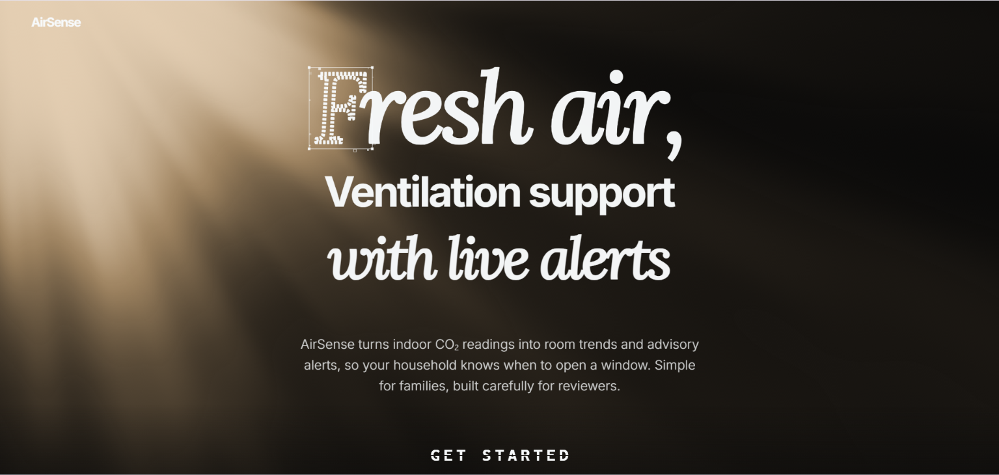
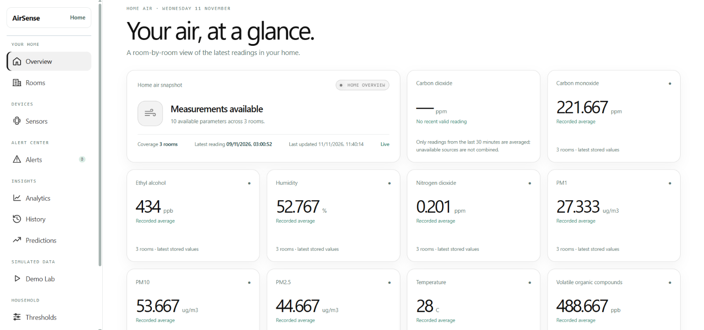
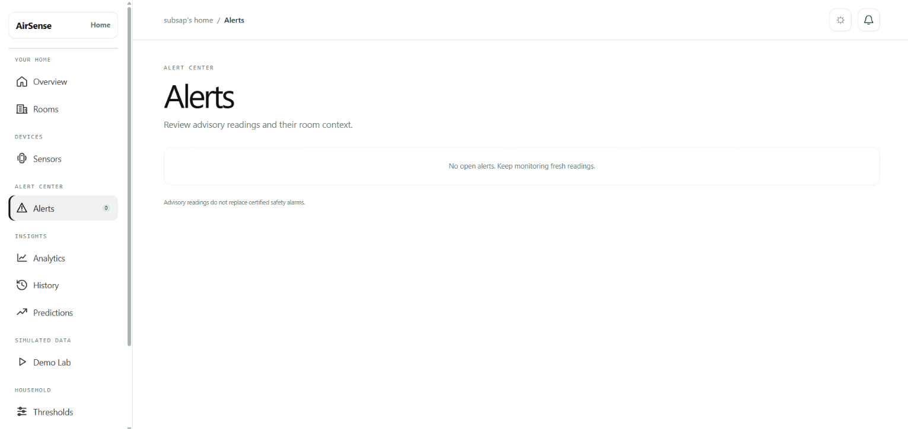
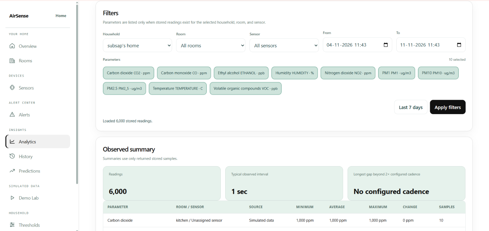
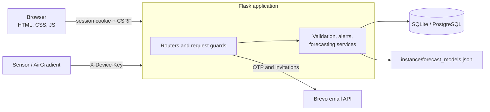

<div align="center">

# AirSense

**Household ventilation-support application: indoor air-quality readings turned into room status, advisory alerts and searchable history.**

[](https://github.com/asvibes/AirSense/actions/workflows/ci.yml)


</div>

> **Project type:** B.Tech academic full-stack project (system design, relational databases, Azure data fundamentals, cloud security)
> **Status:** feature development frozen; documentation and submission phase
> **Last verified commit:** `ce1a862` (10 November 2026)

> [!IMPORTANT]
> AirSense is a ventilation-support **demonstration**. It is not a medical, diagnostic or safety system and does not replace a certified carbon monoxide alarm.

---

## Contents

[Overview](#overview) · [Screenshots](#screenshots) · [Features](#features) · [Technology stack](#technology-stack) · [Architecture](#architecture) · [Getting started](#getting-started) · [Configuration](#configuration) · [Deployment](#deployment) · [Interface and API](#interface-and-api) · [Security](#security) · [Database](#database) · [Testing](#testing) · [Project status](#project-status) · [Documentation](#documentation) · [Limitations](#limitations) · [Future scope](#future-scope)

---

## Overview

AirSense lets a household owner create a home, add rooms, pair sensors and watch air-quality readings (CO₂ first, plus other supported metrics) in one dashboard. Readings are validated on arrival, compared with per-room thresholds to raise advisory alerts, stored for history and export, and used for a simple, honestly validated trend forecast.

| | |
|---|---|
| **Users** | Home owners (manage rooms, sensors, members) and members (view) |
| **Data sources** | Authenticated devices, imported DALTON-style CSV datasets, simulated demo readings. Each reading carries its source label and sources are never mixed in one average. |
| **Scope** | Application, relational database, security controls, tests and documentation. Azure SQL, Blob Storage and Power BI are documented as proposals only (see [Project status](#project-status)). |

## Screenshots

> Screenshots have not been added to the repository yet. Capture them from the running application and store them in `docs/screenshots/`.

## Screenshots

### Landing Page


### Dashboard


### Alerts


### Analytics

## Features

<table>
<tr>
<td width="50%" valign="top">

**Accounts and homes**
- Registration with an emailed 6-digit code
- Login and password recovery
- Home creation, email-bound member invitations
- Owner and member roles

**Rooms and sensors**
- Room management
- Sensor pairing; device key shown once, stored as a peppered hash
- Key rotation and revocation

**Reading ingestion**
- Authenticated device endpoint (`X-Device-Key`)
- Native AirGradient CO₂ payloads (`rco2`)
- Checks for unit, plausible range, timestamp and duplicates
- Source labels: `device`, `dataset`, `simulated`

</td>
<td width="50%" valign="top">

**Alerts**
- High, sustained-elevated and rapid-rise alerts
- Acknowledge and all-clear handling
- Per-room thresholds

**Dashboard**
- Room-wise status, 20-second refresh
- Live and stale indicators, trend arrows
- Separate averages per source

**History and analytics**
- Filters by home, room, sensor, parameter and date
- Charts; CSV and PDF export

**Predictions**
- Per-series linear trend, shown only if it beats a persistence baseline by 5% or more
- Separate offline training command

**Demo lab**
- Simulated readings and replay of up to 1,000 CSV rows

</td>
</tr>
</table>

## Technology stack

| Layer | Technologies |
|---|---|
| Backend | Python, Flask (application factory, 12 blueprints) |
| Frontend | HTML5, CSS3, vanilla JavaScript (no build step) |
| Database | SQLite (local), PostgreSQL (Render, CI) |
| ORM and migrations | SQLAlchemy 2, Alembic |
| Authentication | Session cookies, scrypt, CSRF token |
| Email | Brevo API |
| Testing | pytest, Node.js `node:test` |
| CI/CD | GitHub Actions (SQLite and PostgreSQL jobs) |
| Hosting | Render, Gunicorn |

## Architecture



Routers handle authentication, authorisation and ingestion; services validate readings, evaluate alerts and serve history and predictions; SQLAlchemy persists to SQLite or PostgreSQL. The full diagrams (system architecture, ER, data flow levels 0 and 1) are in [`docs/final_submission/diagrams/`](docs/final_submission/diagrams/).

## Getting started

**Prerequisites:** Python 3.10+, Git, pip, and Node.js (only for the JavaScript tests).

```bash
git clone https://github.com/asvibes/AirSense.git
cd AirSense

python -m venv .venv
source .venv/bin/activate            # Windows PowerShell: .\.venv\Scripts\Activate.ps1

pip install -r requirements.txt
pip install -r requirements-dev.txt  # optional: adds pytest for running tests

python -m alembic upgrade head
python -m flask --app "app.main:create_app()" run
```

Open <http://127.0.0.1:5000/> and choose **Create account**.

- The default database is SQLite at `instance/airsense.sqlite3`. Set `DATABASE_URL` for another SQLAlchemy URL.
- A root `.env` file is loaded automatically and is git-ignored. `.env.example` is a template only and is **not** loaded.
- `AUTO_CREATE_SCHEMA` defaults to `false`; use Alembic migrations.
- Back up any database containing data before running migrations, and check which `DATABASE_URL` the command will use.
- Registration sends an emailed code through Brevo. For local work without email, set `EMAIL_VERIFICATION_REQUIRED=false` and register through the API.

## Configuration

| Variable | Purpose |
|---|---|
| `DATABASE_URL` | Database connection (default: local SQLite) |
| `SECRET_KEY` | Session signing key; production refuses to start with a default |
| `AIRSENSE_DEVICE_KEY_PEPPER` | Device-key hashing secret; required in production |
| `APP_ENV` | Set to `production` on Render |
| `SESSION_COOKIE_SECURE` | `true` when served over HTTPS |
| `TRUSTED_PROXY_HOPS` | Trusted reverse proxies (`0` locally, `1` in production) |
| `BREVO_API_KEY`, `MAIL_DEFAULT_SENDER`, `MAIL_DEFAULT_SENDER_NAME` | Email delivery; sender must be verified in Brevo |
| `PUBLIC_BASE_URL` | Canonical HTTPS URL used in emailed links |
| `EMAIL_VERIFICATION_REQUIRED` | Whether the API demands an emailed code at registration |
| `AIRSENSE_MAX_LIVE_READING_AGE_SECONDS` | Oldest accepted live reading (default 24 hours) |
| `AIRSENSE_HIGH_THRESHOLD`, `AIRSENSE_ELEVATED_THRESHOLD`, `AIRSENSE_ELEVATED_DURATION_SECONDS`, `AIRSENSE_RAPID_RISE_PER_MINUTE`, `AIRSENSE_ALL_CLEAR_DURATION_SECONDS` | Alert defaults (CO₂: 1,500 ppm high; 1,000 ppm for 5 minutes elevated; +200 ppm/min rapid rise) |
| `REQUIRE_API_TOKEN`, `AIRSENSE_API_TOKEN` | Optional bearer-token gate for legacy routes (32+ characters) |
| `PRIVATE_UPLOAD_FOLDER` (or `AIRSENSE_PRIVATE_UPLOAD_FOLDER`) | Room photo storage (default `instance/private_uploads`) |

Never commit real credentials. Threshold defaults are illustrative demo values, not published health guidelines.

## Deployment

`render.yaml` defines one web service that installs requirements, runs `python -m alembic upgrade head` before each deploy, and starts Gunicorn with two workers. Set `DATABASE_URL`, `AIRSENSE_DEVICE_KEY_PEPPER`, `AIRSENSE_API_TOKEN`, the Brevo variables and `PUBLIC_BASE_URL` in the Render dashboard. Production mode refuses to start without a real secret key and pepper.

Render's filesystem is not persistent unless a disk is added, so room photos and `instance/forecast_models.json` can be lost on redeploy.

> The live URL (<https://airsense-85qa.onrender.com>) has not been independently verified for headers, HTTPS configuration or availability. Free-tier Render services can be slow to wake or return 503 while starting.

## Interface and API

The interface is served at `/alerts` after sign-in, with `/history`, `/analytics` and `/predictions` beside it. The application has **69 routes in 12 blueprints**; roughly half are pages and form posts, the rest JSON. Browser requests that change data need the `X-CSRF-Token` header (from `GET /api/me`); devices use `X-Device-Key`.

| Group | Main endpoints |
|---|---|
| Authentication | `POST /api/auth/register/send-otp`, `/register`, `/verify-email`, `/login`, `/logout`, `/forgot-password`, `/verify-reset`, `/reset-password`; `GET /api/me` |
| Homes and members | `GET/POST /api/homes`, `POST /api/active-home`, `GET /api/homes/{id}/members`, `POST /api/homes/{id}/invitations`, `POST /api/invitations/accept` |
| Rooms, sensors, thresholds | `GET/POST /api/homes/{id}/rooms`, `.../sensors`, `.../sensors/{sensor}/rotate-key`, `.../revoke`, `GET/PUT .../thresholds` |
| Readings and alerts | `POST /api/sensors/{sensor}/readings`, `GET /api/homes/{id}/dashboard`, `POST /api/alerts/{alert}/acknowledge`, `GET /api/homes/{id}/activity` |
| History | `GET /api/homes/{id}/history`, `.../history.csv`, `.../history.pdf`, `.../history/options`, `.../predictions` |
| Demo (owner) | `POST /api/homes/{id}/demo/readings`, `POST /api/homes/{id}/demo/replay` |
| Photos | `POST/GET/DELETE /api/homes/{id}/rooms/{room}/photos[/{file}]` (API only) |
| Health | `GET /api/health` |

<details>
<summary><strong>Example device reading</strong></summary>

```bash
curl -X POST https://<host>/api/sensors/<sensor_id>/readings \
  -H "X-Device-Key: <device key>" \
  -H "Content-Type: application/json" \
  -d '{"room": "Bedroom", "metric": "CO2", "value": 820, "unit": "ppm", "measured_at": "2026-11-09T10:30:00Z"}'
```

A native AirGradient payload containing `rco2` is also accepted and stored as CO₂ in ppm. Its room must match the sensor's room; other AirGradient fields are ignored.

</details>

The complete reference is in [`docs/final_submission/06_api_reference.md`](docs/final_submission/06_api_reference.md). List routes locally with `python -m flask --app "app.main:create_app()" routes`.

Sessions use HttpOnly, SameSite cookies, and mutation requests require a CSRF token. Home-scoped routes enforce owner/member membership. Device ingestion uses per-sensor keys whose peppered hashes are stored in the database.
Authentication and abuse-sensitive routes use database-backed rate-limit buckets shared across workers. Set `TRUSTED_PROXY_HOPS` only when the deployment has a known proxy chain; leave it at `0` to ignore forwarded client headers.

The application emits content-type, clickjacking, referrer, permissions, and CSP headers. HSTS is emitted only for secure production requests. HTTPS, production database network restrictions, and cloud secret configuration must still be configured and verified before public deployment.

## Dashboard

The responsive frontend is served from `/alerts` after sign-in. It loads rooms, readings, alerts, sensor status, thresholds, household members, and activity from the authenticated backend APIs.

Features include:

* **Overview:** Summary cards and a latest-reading bar chart for metrics recorded in the selected home.
* **Room management:** Owners can create rooms and edit room names and multiple ventilation sources per room. Room deletion is not implemented.
* **Sensor management:** Owner-managed sensor provisioning, key rotation, and revocation. A provisioned key is shown once; only its hash is stored.
* **Sensor ingestion:** Submit device readings using per-sensor keys through the same alert evaluation path used by simulator readings.
* **Alert management:** View alert history and acknowledge alerts while authenticated.
* **Threshold configuration:** Persist per-room, per-metric advisory thresholds. CO₂ receives the configured defaults; other parameters have alerts disabled until a threshold is explicitly set.
* **History and export:** Filter stored readings by household, room, sensor, metric, and date range; inspect timestamped samples and gaps; export CSV or a multi-page PDF report.
* **Analytics:** Review observed minimum, average, maximum, and change summaries; compare series by room/sensor; view actual samples or daily, weekly, and monthly averages. Empty periods are not synthesized.
* **Predictions:** A dedicated page reports forecasts only when a per-series linear trend beats a persistence baseline by at least 5% on a later chronological holdout. Unsupported series and horizons remain unavailable; simulated readings are excluded from training.
* **Household management:** Owners can invite members and review activity history.
* **Room photos:** Authenticated home members can upload, view, and delete private JPEG, PNG, or WebP room photos (maximum 5 MB each).
* **Simulation:** Submit simulated readings to the server-side alert pipeline.
* **Environmental dataset replay:** Import supported timestamped measurements from a CSV, including CO₂, particulate matter, temperature, humidity, CO, NO₂, VOC, and compatible custom measurements with explicit units. Historical dataset readings retain their timestamps and do not create live alerts.
* **DALTON replay:** Upload a processed DALTON CSV and replay valid CO₂ samples through that same alert pipeline. Samples are labeled as recorded data; timestamps can be shifted for a current demo.
* **AirGradient:** Provisioned devices can push their `rco2` CO₂ value to the existing device-authenticated reading endpoint.
* **Appearance:** Persist the light/dark theme preference.

The browser interface uses plain HTML, CSS, and vanilla JavaScript. No separate frontend build or third-party browser package is required.

Invitation links are single-use and expire after 24 hours. Email delivery is configured through the Brevo adapter when deployment credentials and a verified sender are supplied.

Room photos are stored outside Flask's public static directory under `instance\private_uploads` by default. Set `PRIVATE_UPLOAD_FOLDER` (or `AIRSENSE_PRIVATE_UPLOAD_FOLDER`) to a private persistent directory in deployments where the application filesystem is ephemeral. Photo routes verify home membership and that the room belongs to the requested home.

DALTON source data is not bundled. In the Demo Lab, upload a CSV (up to 16 MB) with one timestamp column (`ts`, `timestamp`, `datetime`, or similar) and any supported measurement columns; CO₂ is optional. Common aliases and explicit units are recognized and converted only when the conversion is defined. The documented DALTON headers and units are applied only to files matching the DALTON schema; other unitless or ambiguous columns are reported for review and not imported. The app imports up to 1,000 rows per replay, skips duplicate metric/timestamp pairs, and reports skipped duplicates. Original timestamps are kept by default; optional shifting moves the newest sample to the present while retaining sample spacing. Historical dataset readings are stored for dashboard, History, Analytics, and Predictions, but do not produce active alerts. See [DALTON replay notes](docs/dalton-notes.md).

## API Overview

Account and home API routes use the signed-in session. Authenticated `POST`, `PUT`, `PATCH`, and `DELETE` requests require the `X-CSRF-Token` header. The dashboard obtains the token from the server-rendered page.

Device ingestion uses the `X-Device-Key` header for sensor authentication.
AirGradient device push payloads containing `rco2` are normalized to CO₂ ppm and use this same authenticated route, validation, rejection, and reading-processing path.

| Endpoint | Purpose |
|---|---|
| `GET /api/health` | Check application/database availability; no account session required. |
| `GET /api/me` | Return the signed-in account, CSRF token, and homes. |
| `POST /api/auth/register`, `POST /api/auth/login`, `POST /api/auth/logout` | Register, sign in, and sign out. |
| `GET /api/homes`, `POST /api/homes` | List or create homes for the signed-in user. |
| `POST /api/active-home` | Select a home in the session. |
| `GET /api/homes/{home_id}/dashboard` | Get current dashboard readings and alerts. |
| `GET /api/homes/{home_id}/rooms`, `POST /api/homes/{home_id}/rooms` | List or create rooms. |
| `PATCH /api/homes/{home_id}/rooms/{room_id}` | Update a room name and/or ventilation sources; owner only. Room deletion is not implemented. |
| `GET /api/homes/{home_id}/sensors`, `POST /api/homes/{home_id}/sensors` | List or provision sensors; provisioning returns a one-time device key. |
| `POST /api/homes/{home_id}/sensors/{sensor_id}/rotate-key`, `POST /api/homes/{home_id}/sensors/{sensor_id}/revoke` | Rotate a sensor key or revoke the sensor. |
| `POST /api/sensors/{sensor_id}/readings` | Submit a validated reading using `X-Device-Key`. |
| `POST /api/homes/{home_id}/demo/readings`, `POST /api/homes/{home_id}/demo/replay` | Submit simulator readings or replay a timestamped environmental CSV. |
| `GET /api/homes/{home_id}/thresholds`, `PUT /api/homes/{home_id}/thresholds` | Read or batch-update per-room, per-metric thresholds. |
| `POST /api/homes/{home_id}/rooms/{room_id}/photos` | Upload a private JPEG, PNG, or WebP room photo as multipart `photo`. |
| `GET /api/homes/{home_id}/rooms/{room_id}/photos/{filename}` | Retrieve an authorized room photo. |
| `DELETE /api/homes/{home_id}/rooms/{room_id}/photos/{filename}` | Delete an authorized room photo. |
| `PUT /api/homes/{home_id}/thresholds/{room_id}/{metric_code}` | Update one room/metric threshold. |
| `GET /api/homes/{home_id}/history`, `GET /api/homes/{home_id}/history.csv` | Get filtered history or export it as CSV. |
| `GET /api/homes/{home_id}/history/options` | List stored metrics for the selected room and sensor filters. |
| `GET /api/homes/{home_id}/history.pdf` | Export a PDF report for the selected history filters. |
| `GET /api/homes/{home_id}/predictions` | List saved model evaluations or request a validated forecast for a stored series. |
| `GET /api/homes/{home_id}/members`, `POST /api/homes/{home_id}/invitations` | List members or create a single-use invitation. |
| `POST /api/invitations/accept`, `DELETE /api/homes/{home_id}/members/{user_id}` | Accept an invitation or remove a non-owner member. |
| `GET /api/homes/{home_id}/activity` | Read the home activity log (owner only). |
| `GET /api/dashboard?home_id=...`, `GET /api/alerts?home_id=...`, `POST /api/policies`, `POST /api/readings`, `POST /api/alerts/{alert_id}/acknowledge` | Legacy authenticated dashboard/alert routes retained for compatibility. |

Authenticated mutating routes use session authentication and CSRF protection. Device ingestion is authenticated separately with the sensor key. `REQUIRE_API_TOKEN` is an optional additional gate in the legacy alerts blueprint; it does not replace session, membership, or device authentication and is not a global API gate.

Forecast training is a separate offline task and is never run during page or API loading. Run `python -m app.ml.train` after adding real device or dataset readings. It evaluates each home/room/sensor/metric series with an 80/20 chronological split, compares the linear time trend with a persistence baseline, and writes model/evaluation results to `instance/forecast_models.json`. Series with fewer than 30 distinct timestamps or without the required holdout improvement are saved as unavailable, not forecast.

## Security

| Control | Implementation |
|---|---|
| Passwords and sessions | scrypt hashes; HttpOnly, SameSite=Lax cookies (Secure in production); `session_version` signs out other sessions after a reset |
| CSRF | Token required on every browser POST, PUT, PATCH and DELETE |
| Email codes and recovery | 6-digit code, hashed, 10 minutes, 5 attempts, 60-second resend cooldown; reset tokens hashed, single use, 15 minutes |
| Authorisation | Every home route checks `owner` or `member`; reading, room, sensor, threshold, invitation, import and activity routes are owner-only |
| Devices | Per-sensor keys stored as peppered hashes; failed attempts written to the audit log |
| Rate limiting | Database-backed buckets shared across workers (login, codes, invitations, device readings, demo) |
| Invitations | Hashed, bound to the invited email, single use, 24 hours |
| Uploads and exports | Type, magic-byte and size checks; random names; private folder; CSV formula escaping |
| Headers | CSP, `X-Frame-Options`, nosniff, referrer and permissions policies; HSTS on secure production requests |
| Audit | `audit_logs` table records relevant security events |

**Known weaknesses** (documented, not hidden):
- The CSP still allows inline scripts and styles.
- `render.yaml` sets `EMAIL_VERIFICATION_REQUIRED=false`, so accounts created through the API are not email-verified and an existing address can be detected at registration in that mode.
- There is no per-room photo quota, and accepting an invitation at login has no confirm step.
- There is no application logging beyond the email module.
- HTTPS, database network rules and monitoring depend on the host and were not verified.

See the threat model and security checklist in [`docs/final_submission/`](docs/final_submission/).

## Database

SQLAlchemy 2 models with **13 tables** and **8 Alembic migrations** (latest `20261108_0008`).

| Domain | Tables |
|---|---|
| Identity and access | `users`, `homes`, `home_memberships`, `home_invitations`, `email_challenges` |
| Devices and rooms | `rooms`, `sensors`, `metrics` |
| Readings and alerts | `air_readings`, `threshold_policies`, `air_alerts` |
| Platform | `audit_logs`, `rate_limit_buckets` |

- Duplicate readings (same home, room, metric and time) are rejected.
- A partial unique index allows one open alert per home, room, metric and level.
- Ingestion runs in a single transaction.
- Room photos are files, not database rows.
- Migrations were run (upgrade, downgrade, upgrade) on SQLite and PostgreSQL 16.

The scripts in [`database/`](database/README.md) describe a separate Azure SQL schema. They were never run on Azure SQL and are not used by the application.

## Testing

```powershell
python -m pip install -r requirements-dev.txt
python -m pytest -q
```

Create a demo home for an existing account (after applying migrations):

```powershell
python tools/seed_demo_home.py --email owner@example.com
```

The three JavaScript tests require Node.js:

```powershell
node --test tests/dashboard_live_updates.test.js
node --test tests/dashboard_room_trends.test.js
node --test tests/dashboard_co2_averages.test.js
```

| Check and evidence baseline | Result |
|---|---|
| Python tests (`27a83d1`, local run) | 202 passed, 14 warnings |
| JavaScript tests | Not run in the verification environment; Node.js was unavailable |
| Python line coverage | Not measured |
| PostgreSQL CI (`0fe75da`) | All three CI jobs passed |
| Migrations on SQLite | Upgrade, downgrade, and upgrade passed |

Use `pytest`, not `python -m unittest discover`: the newer test files are pytest-style, so `unittest` finds only 186 of the 202.

**What is not covered:** real hardware, real DALTON data, live Brevo delivery, load testing, penetration testing and Azure integration. Dashboard behaviour was checked in a headless browser with ad hoc scripts that are not stored in the repository. The CI result above is the verified run for commit `0fe75da`; later CI runs were not checked for this evidence snapshot.

Useful migration commands: `python -m alembic current`, `python -m alembic history`.

## Project status

| Component | Status | Notes |
|---|---|---|
| Accounts, roles, invitations | Implemented, tested | Production keeps email verification off; no role-change screen |
| Rooms and sensors | Implemented | No room deletion; no moving a sensor between rooms |
| Reading ingestion and alerts | Implemented, tested | AirGradient CO₂ only; real hardware never connected |
| Dashboard | Implemented | Checked in a headless browser only |
| History, analytics, exports | Implemented | Real DALTON data never loaded |
| Predictions | Implemented | Accuracy on real data unknown; training is manual |
| Photo uploads | API only | No screen |
| Analytics report | Standalone HTML, generated by `tools/generate_analytics_report.py` | 1,512 synthetic rows; not a Power BI file |
| PWA | Not implemented | `manifest.webmanifest` and `sw.js` are empty |
| Azure SQL, Blob Storage, Power BI | Not implemented | `.pbix` is a zero-byte placeholder |

Feature development is frozen; remaining work is documentation, verification and submission material.

## Documentation

The submission pack in [`docs/final_submission/`](docs/final_submission/) contains 15 documents:

| # | Document | # | Document |
|---|---|---|---|
| 1 | Submission index and summary | 9 | Security checklist |
| 2 | Requirements, scope, traceability | 10 | Test and submission evidence |
| 3 | Architecture and data flow | 11 | Technology stack and module map |
| 4 | ER diagram and database design | 12 | User manual |
| 5 | SQL artifacts and schema status | 13 | Data flow diagrams |
| 6 | API reference | 14 | B.Tech final project report (draft) |
| 7 | Setup and user guide | 15 | Final submission checklist |
| 8 | Data classification and threat model | | |

Additional design notes: [`docs/PRD.md`](docs/PRD.md), [`docs/architecture.md`](docs/architecture.md), [`docs/data-model.md`](docs/data-model.md), [`docs/alert-lifecycle.md`](docs/alert-lifecycle.md), [`docs/reading-validation.md`](docs/reading-validation.md), [`docs/dalton-notes.md`](docs/dalton-notes.md), [`docs/threshold-sources.md`](docs/threshold-sources.md).

## Limitations

- An academic demonstration, not a medical or safety system; thresholds are illustrative.
- It does not measure air quality itself; it processes submitted readings. Verify units and sensor ranges before any real use.
- Real hardware integration, real DALTON replay and Brevo delivery have not been verified end to end.
- Dataset replay needs a CSV you provide; imported historical rows do not create live alerts.
- Alerts appear on the dashboard only; there are no email or push alerts.
- Photos and forecast models use local disk, which Render may reset on redeploy.
- Azure SQL, Blob Storage and Power BI are not implemented.
- Production infrastructure, monitoring and load behaviour are unverified.

## Future scope

These are possible extensions, not implemented features:

- Connect physical AirGradient hardware and ingest more than CO₂
- Persistent cloud storage for photos and models
- Progressive Web App support
- Email and push alerts
- Better forecasting on larger real datasets

---

<sub>AirSense was developed as a B.Tech academic project to demonstrate application development, relational database design, data processing, application security and basic predictive analytics. It is intended for educational and demonstration use only.</sub>