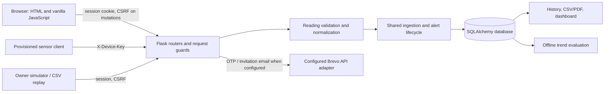

# System architecture and data flow

## Implemented architecture

AirSense is implemented as a Flask modular monolith. Flask serves HTML templates and static JavaScript/CSS; browser code calls same-origin routes. Routers call shared services and SQLAlchemy models. The default local database is SQLite. PostgreSQL URL normalization and CI migration/test jobs are present, but a successful PostgreSQL CI run was not verified. The Azure SQL files are a separate proposed target.

The diagram presents code paths, not a deployed topology. There is no separate frontend service, no verified Azure resource, and no active Blob Storage integration.

## Sensor and simulated-reading flow

1. A sensor request targets `POST /api/sensors/<sensor_id>/readings` and supplies `X-Device-Key`.
2. The route checks sensor existence, active status, a keyed hash of the supplied device key, and a database-backed rate limit.
3. An AirGradient-style JSON object containing `rco2` is mapped to a CO2/ppm reading for the room already assigned to that sensor. Other supported reading payloads pass the same validator.
4. Validation canonicalizes metric/unit values, checks finite and plausible values, and normalizes timezone-aware timestamps.
5. The shared ingestion service checks timing constraints, resolves home/room/metric scope, records receipt time, invokes the alert repository, updates sensor last-seen state, and records an audit event.
6. Reading/alert changes are persisted transactionally. A duplicate key or invalid request is returned as an error rather than reported as success.
7. Authorized users retrieve room/dashboard/history data through home-scoped APIs.

The simulator path is restricted to an authenticated home owner and records source `simulated`. The dataset replay path parses a CSV, limits the file to 16 MB and a replay to at most 1,000 rows, validates records, and stores them with source `dataset`. Dataset values are historical records and do not create live alerts through the shared batch path.

## Alert and history flow

Threshold evaluation compares a reading against the room/metric policy. The implemented levels are `high`, sustained `elevated`, and `rapid_rise`. Alert rows can be active, acknowledged, or all-clear. A unique filtered index prevents multiple open alerts at the same home/room/metric/level. The all-clear process requires a configured below-threshold duration and respects the maximum reading gap.

History endpoints apply authorization and bounded filters before returning readings. CSV output uses cell-safety handling; the PDF route delegates to the report service. These are application implementations; export quality and browser rendering were not independently reviewed in a production browser during this documentation task.

## Forecast flow

Forecast training is an offline command (`python -m app.ml.train`), not part of request-time ingestion. The implementation sorts distinct timestamps, splits chronologically, evaluates a linear time trend against a persistence baseline, and saves evaluation/model data under the application instance path. The endpoint only returns forecasts for stored available models and constrains horizons to 24 hours. It is not evidence of model generalization, academic benchmark performance, or prediction accuracy on real homes.

## Trust boundaries and deployment distinction

| Boundary | Code-level behavior | Not established by local code review |
|---|---|---|
| Browser to Flask | Signed session, CSRF validation for mutations, membership/role checks | HTTPS at a live endpoint, browser E2E, external penetration test |
| Sensor to Flask | Per-sensor key checked against keyed hash; active/revoked state and rate limit | Device provisioning in the field, key storage on actual hardware |
| Flask to database | SQLAlchemy sessions; SQLite foreign keys enabled by connection setup | Azure SQL connectivity, successful PostgreSQL CI run, production backups/restore |
| Flask to email provider | Brevo adapter exists and uses configuration | Verified sender/domain, delivery success, DNS authentication |
| Data/report storage | Room photos use a private local path; forecasts stored under instance path | Durable private cloud object storage, retention policy, hosted access policy |

The `render.yaml` file describes a deployment configuration, but this repository audit does not verify a reachable service or its deployed settings. Azure is not represented as an active application integration.

## Diagram files

- [System architecture PNG](diagrams/system_architecture.png) — rendered view
- [System architecture SVG](diagrams/system_architecture.svg) — editable vector source
- [DFD Level 0 PNG](diagrams/dfd_level_0.png) and [editable SVG](diagrams/dfd_level_0.svg)
- [DFD Level 1 PNG](diagrams/dfd_level_1.png) and [editable SVG](diagrams/dfd_level_1.svg)

The DFD definitions, boundaries, and store mappings are summarized in [document 13](13_data_flow_diagrams.md).
