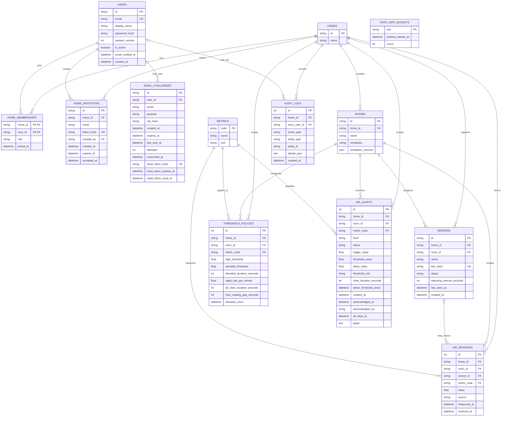

# ER diagram and active database design

## Schema status

This diagram summarizes the active SQLAlchemy model classes in `app/models/`, not the separate Azure SQL proposal under `database/migrations/`. The current metadata contains 13 application tables. Alembic adds its own `alembic_version` bookkeeping table when migrations are applied.

### Rendered diagram

The high-resolution diagram includes every active model table, field, key/FK marker, and relationship/cardinality summary:

- [ER diagram PNG](diagrams/er_diagram.png)
- [Editable ER diagram SVG source](diagrams/er_diagram.svg)

## Relationships and constraints

- A membership is identified by the composite `(home_id, user_id)` key; application roles currently use `owner` and `member`.
- Room names are unique within a home, including a case-insensitive unique functional index.
- Sensor status is constrained to active/revoked; reporting intervals are constrained to 30–86,400 seconds. Device-key hashes are unique.
- Threshold policies are unique for a home, room, and metric. Policies are current values and are not effective-dated in the active ORM schema.
- Readings have uniqueness across home, room, metric, and measured time. `received_at` is nullable for historic rows.
- Active/acknowledged alerts use a filtered unique index by home, room, metric, and level. Alert status/level and transition metadata have checks.
- Email OTP/reset challenge records store hashes and expiry/attempt state. Rate-limit counters are persisted in the database.
- `email_challenges` contains nullable `user_id`, `consumed_at`, and reset-token state; `rate_limit_buckets` is independent and has no declared foreign key.

## Important integrity limitation

Several rows hold both `home_id` and `room_id`, while independent foreign keys ensure each referenced row exists. The active schema does not use composite foreign keys to ensure those two references always belong to the same home. Application routes enforce home/room membership in normal flows, but direct SQL or future code can still create an inconsistent association. A reading's optional sensor reference likewise is not constrained by a composite home/room relationship.

## Migration chain

The active Alembic chain is `20261027_0001` → `20261028_0002` → `20261028_0003` → `20261105_0004` → `20261107_0005` → `20261108_0006` → `20261108_0007` → `20261108_0008`. It adds core schema, room ventilation sources, nullable reading receipt time, email challenge/reset state, rate limits, and email-verification state. Local tests exercise migration paths on disposable SQLite databases. This does not verify a production migration or Azure SQL compatibility.

## Design references

The canonical model definitions are in `app/models/`; migration files are in `migrations/versions/`. See [document 5](05_sql_artifacts_and_schema_status.md) before considering the SQL Server target scripts. The existing [data-model document](../../docs/data-model.md) is useful background but predates some active authentication tables; this diagram includes those current models.
