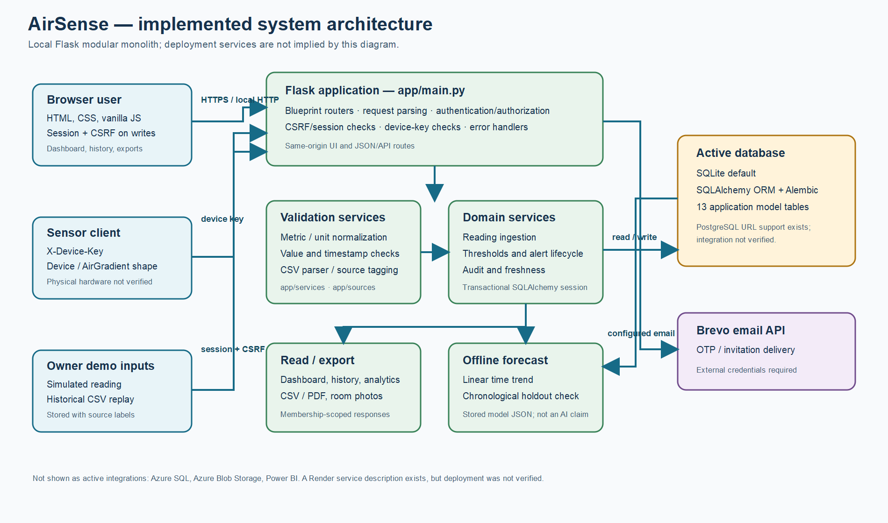
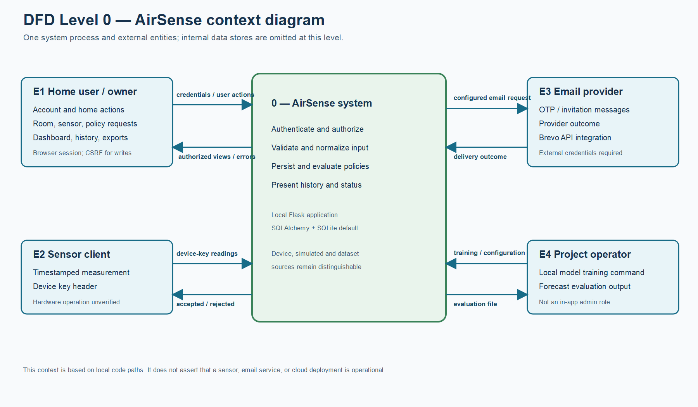
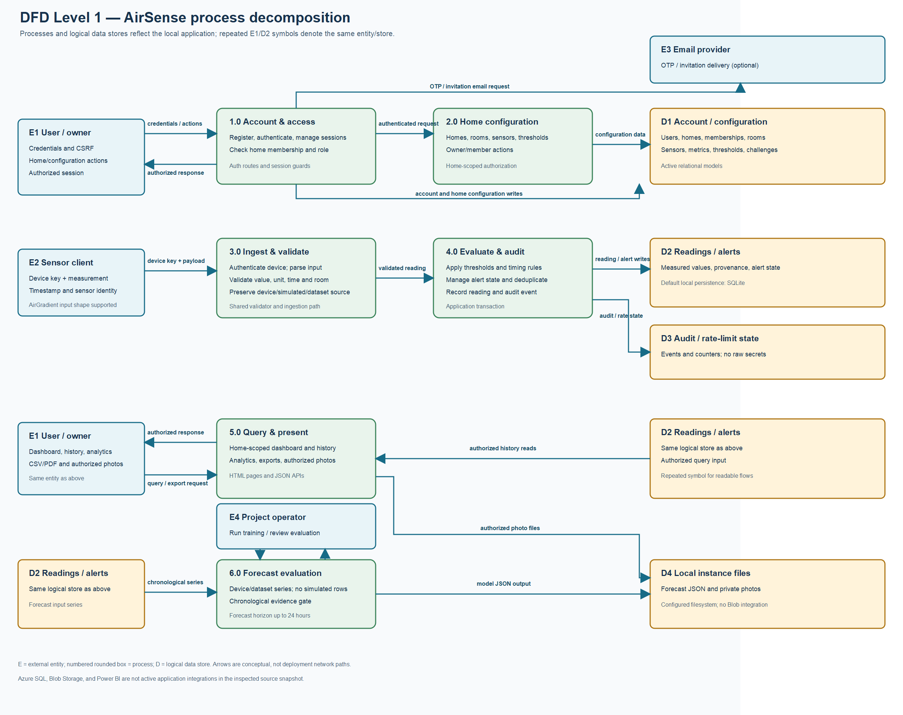
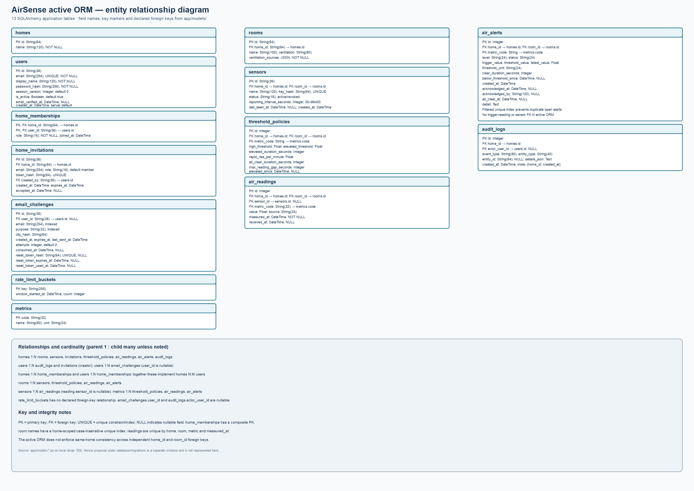

# AirSense
## Indoor Air Readings, Ventilation Alerts and Historical Trend Analysis

### B.Tech Computer Science and Engineering (AI/ML) — Final Project Report

**Institution:** [Insert verified institution name]<br>
**Department:** [Insert department name]<br>
**Academic year / semester:** [Insert verified period]<br>
**Student name(s):** [Insert name(s) and roll number(s)]<br>
**Project guide:** [Insert guide name and designation]<br>
**Submission date:** [Insert date]

> **Evidence statement:** This report describes the local `divija` application at pushed commit `27a83d1` as of 10 November 2026. A fresh Python test run started from that clean commit and reported 202 passing tests. Later changes during this review are documentation-only. GitHub Actions push and pull-request runs for `0fe75da` passed all configured jobs, including PostgreSQL tests and migrations. No Azure service, physical sensor deployment, or operational public deployment is claimed.

> **Submission status:** This Markdown report is an academic draft, not a completed institutional submission. Replace the marked placeholders, apply the institution's required format, and remove this notice only after the remaining items in the [final submission checklist](15_final_submission_checklist.md) have been verified.

## Certificate

This is to certify that the project report titled **“AirSense: Indoor Air Readings, Ventilation Alerts and Historical Trend Analysis”** is submitted by **[student name(s), roll number(s)]** in partial fulfilment of the requirements for the degree of Bachelor of Technology in Computer Science and Engineering at **[institution]**, under the guidance of **[guide name]**.

**Project guide:** ____________________  **Date:** __________<br>
**Head of department:** _______________  **Date:** __________<br>
**Institution seal:** [Insert official seal, if required by the institution]

This certificate is a template and is not signed or institutionally verified.

## Student declaration

We, **[student name(s)]**, declare that this report describes the AirSense project work submitted by us and that any external material used in the final submission will be cited according to the institution's rules. We will replace all placeholders, verify all cited material, and ensure that screenshots, measurements, and deployment statements represent evidence actually collected by the project team.

**Student signature(s):** ____________________  **Date:** __________

## Acknowledgements

[Add acknowledgements only after confirming the people and support to be acknowledged. Remove this instruction if no acknowledgement is required.]

## Abstract

Indoor-air measurements are difficult to interpret when they are distributed across rooms, devices, and time. AirSense is a web application developed to organize room-associated environmental readings, apply configurable rule-based thresholds, and present alerts and historical data to household users. The implementation is a Flask modular monolith with server-rendered HTML and vanilla JavaScript, SQLAlchemy persistence, and Alembic schema migrations. SQLite is the local default database.

The system supports account/session flows, home-scoped owner/member authorization, room and sensor management, device-key-authenticated ingestion, simulated readings, environmental CSV replay, configurable threshold policies, an alert lifecycle, history and exports, and a conditional offline forecasting workflow. Reading sources are represented as device, simulated, or dataset data. The forecasting implementation fits a linear trend to time-indexed series and compares it with a persistence baseline using a chronological holdout; it does not claim general predictive accuracy or establish a sophisticated AI model.

The fresh local Python test run on pushed commit `27a83d1` reported **202 passed, 14 warnings in 95.14 seconds**. In addition, the push and pull-request GitHub Actions runs for `0fe75da` passed all configured CI jobs, including the PostgreSQL test and migration jobs. This is evidence of selected automated behavior only. The repository does not establish a deployed Azure solution, completed Power BI report, Azure Blob integration, or physical sensor calibration. Browser end-to-end testing was not performed. AirSense is a software monitoring aid, not a medical diagnostic or certified safety device.

**Keywords:** indoor air, CO2, Flask, sensor ingestion, threshold alert, data provenance, time-series trend, web application.

## Table of contents

1. [Introduction](#1-introduction)
2. [Background and related technical work](#2-background-and-related-technical-work)
3. [Requirements and scope](#3-requirements-and-scope)
4. [System analysis and architecture](#4-system-analysis-and-architecture)
5. [Database design](#5-database-design)
6. [Implementation](#6-implementation)
7. [Forecasting method](#7-forecasting-method)
8. [Security, privacy and limitations](#8-security-privacy-and-limitations)
9. [Testing, results and discussion](#9-testing-results-and-discussion)
10. [Conclusion and future work](#10-conclusion-and-future-work)
11. [References and project artifacts](#11-references-and-project-artifacts)
12. [Appendices](#12-appendices)
13. [Figure and screenshot register](#figure-and-screenshot-register)

## Abbreviations

| Term | Meaning |
|---|---|
| API | Application Programming Interface |
| CO2 | Carbon dioxide |
| CSRF | Cross-Site Request Forgery |
| DFD | Data-Flow Diagram |
| ER | Entity-Relationship |
| HTTP | Hypertext Transfer Protocol |
| ORM | Object-Relational Mapper |
| OTP | One-Time Password |
| PDF | Portable Document Format |
| SQL | Structured Query Language |
| UTC | Coordinated Universal Time |

## 1. Introduction

### 1.1 Context

AirSense was developed as an academic software project around the organization and interpretation of indoor environmental readings. It receives data from a configured sensor client or from explicit simulation/dataset workflows; the software itself has no sensing hardware. Its main tasks are to attach measurements to a home and room, validate and persist them, evaluate configured threshold policies, and make data available to authorized users.

### 1.2 Problem statement

Room-level readings can be difficult to compare over time or interpret consistently when records lack a shared storage and presentation layer. The project addresses the software-side problem of collecting timestamped values from supported inputs, associating them with household locations, retaining source labels, and presenting rule-based alerts and historical summaries.

The project does not establish that every household has an accurate CO2 sensor, nor does it provide a clinical, health, or building-code interpretation of the resulting data.

### 1.3 Objectives

1. Provide local account and home-scoped access workflows.
2. Support room and provisioned-sensor records.
3. Validate measurements and maintain units, timestamps and source provenance.
4. Apply configurable threshold and alert lifecycle rules.
5. Present authorized dashboards, history and exports.
6. Provide clearly distinguished simulator and dataset replay workflows.
7. Evaluate a simple offline time-trend method only when minimum data and holdout checks pass.
8. Verify selected behavior with automated tests and document known deployment gaps.

### 1.4 Scope

The implemented scope is the local Flask application documented in the repository. Azure SQL, Azure Blob Storage and Power BI appear as separate target artifacts or project requirements, but are not active application integrations. Hardware, external email delivery, deployment operation and ML validity remain outside the verified evidence.

## 2. Background and related technical work

### 2.1 Application pattern

The implementation uses a modular monolith: Flask routers handle HTTP requests, services apply domain logic, SQLAlchemy models represent relational data, and Alembic tracks schema changes. The browser UI is served from the same application and calls same-origin routes. This keeps the demonstrated architecture simple for an academic project and avoids claiming separately deployed frontend/backend services.

### 2.2 Event time, receipt time and provenance

A measurement has a `measured_at` event timestamp and a nullable `received_at` server timestamp. These represent distinct concepts: when the measurement says it occurred, and when the application received it. Existing rows can have unknown receipt time. The reading `source` field distinguishes device, simulated and dataset input; this distinction is necessary because synthetic or imported history should not be misrepresented as live sensor data.

### 2.3 Rule-based alerts and statistical forecasts

The alert engine uses deterministic policies for high values, sustained elevated readings and rapid increases, plus acknowledgement and all-clear behavior. These rules are configurable application behavior, not a scientific certification of safety thresholds.

The forecasting subsystem is intentionally narrower than a general AI/ML platform. It fits a straight-line time trend with application code, evaluates later observations against a constant persistence baseline, and withholds forecasts unless a minimum-sample and holdout-improvement criterion passes. This provides a transparent statistical demonstration; it does not establish superiority over models on new households or future periods.

### 2.4 Literature review status

No peer-reviewed literature bibliography or sensor-validation protocol was found in the project repository during this audit. The report therefore describes technical foundations and actual implementation rather than inventing a scholarly survey. If the college rubric requires domain research citations, students must add independently reviewed sources and connect their claims to those sources.

**Academic completion requirement:** Consult the department rubric and add genuine, cited academic sources on indoor-air quality and ventilation, the interpretation and limitations of CO2 as an indoor indicator, and time-series forecasting/evaluation. Add sensor-calibration references only if the team has actual hardware measurements to discuss. Use sources that the team has read and verified; do not cite these topics based on this list alone.

## 3. Requirements and scope

### 3.1 Functional requirements and status

| Requirement | Implemented behavior | Status |
|---|---|---|
| Account access | Registration, login/logout, session protection, optional email OTP and password reset | Local code present; live mail delivery not verified |
| Household authorization | Home-scoped `owner` and `member` roles | Implemented; no global administrator/facility manager role |
| Room management | Create and edit room names/ventilation sources | Delete not implemented |
| Sensor administration | Provision, rotate key, revoke; store keyed hash | Implemented in code; no hardware deployment evidence |
| Reading ingestion | Device-key endpoint and shared validation/ingestion path | Implemented locally |
| Demo/dataset input | Owner simulator and timestamped environmental CSV replay | Implemented; provenance retained |
| Thresholds and alerts | High, sustained elevated, rapid rise, deduplication, acknowledgement and all-clear | Implemented; thresholds illustrative |
| History and exports | Filtered history, CSV, PDF and analytics pages | Code present; no production browser validation |
| Forecast | Offline linear trend with chronological holdout | Implemented as a simple statistical model; not externally validated |
| Audit/security | Selected home-scoped events, validation, access controls, rate limits and response headers | Implemented partially; no independent security audit |
| Cloud analytics/storage | Azure SQL proposal, PBIX placeholder, no active Blob adapter | Not completed/verified |

### 3.2 Non-functional considerations

The code includes input validation, explicit source labels, relational constraints, session/CSRF protections, device key checks, configurable request limits and migration tooling. No load benchmark, formal accessibility audit, production restore test, formal privacy assessment or public deployment audit was collected.

### 3.3 Roles

`owner` and `member` are assigned per home. Owners can perform management actions such as room/sensor/threshold configuration; members can access permitted home data and functions. Authorization is enforced in request paths. These are not equivalent to the proposed global roles in the product requirements document.

### 3.4 Method and evidence basis

This report is a code-based project account. Implemented behavior is described from the local application, model, migration, configuration, and test files; the test outcome is reported separately in Section 9. The available evidence does not establish a formal user study, field experiment, sensor calibration study, or deployed-system evaluation. Any such methods or results must be added only if the project team has records of having conducted them.

## 4. System analysis and architecture

### 4.1 Architecture

The Flask app factory registers domain blueprints, initializes SQLAlchemy and applies security/error handling. Routers call shared services and repositories. Templates and static JavaScript/CSS are delivered by Flask. SQLite is the default local database; PostgreSQL URL normalization is present but integration testing is not claimed. The architecture diagram is an exported view of the local implementation, not a deployed topology.

**Figure 4.1. Implemented system architecture.**<br>


[Open the full-size architecture PNG](diagrams/system_architecture.png) · [Editable SVG source](diagrams/system_architecture.svg)

### 4.2 DFD Level 0

The context DFD models one AirSense system and three external parties: a home user/owner, a sensor client, and a configured email provider. A local project operator may run offline training. User actions and readings enter the system; authorized dashboards/exports and acceptance/rejection outcomes leave it. Email is conditional on provider configuration.

**Figure 4.2. DFD Level 0 — context diagram.**<br>


[Open the full-size DFD Level 0 PNG](diagrams/dfd_level_0.png) · [Editable SVG source](diagrams/dfd_level_0.svg)

### 4.3 DFD Level 1

The main processes are (1) account/access, (2) home configuration, (3) ingestion/validation, (4) threshold evaluation and audit, (5) query/presentation, and (6) offline forecast evaluation. The data stores represent active relational entities and local instance files; they are not cloud resources.

**Figure 4.3. DFD Level 1 — process decomposition.**<br>


[Open the full-size DFD Level 1 PNG](diagrams/dfd_level_1.png) · [Editable SVG source](diagrams/dfd_level_1.svg)

### 4.4 Reading lifecycle

For a device request, the server applies rate limiting, resolves the sensor, checks the active state and device key, normalizes an AirGradient-style payload when present, validates room/value/unit/timestamp, and invokes the shared ingestion service. The service records the server receipt time, resolves database scope, applies alert logic, updates last-seen state, records audit information and commits the transaction.

Simulator requests are authenticated with a home session and are labelled `simulated`. Environmental replay is parsed and validated in a batch and labelled `dataset`; the batch replay path does not generate live alerts. Device and demo traffic should not be merged in reports without preserving source.

## 5. Database design

### 5.1 Active ORM entities

The active model has 13 application tables: `homes`, `users`, `home_memberships`, `home_invitations`, `email_challenges`, `rate_limit_buckets`, `rooms`, `sensors`, `metrics`, `threshold_policies`, `air_readings`, `air_alerts`, and `audit_logs`.

**Figure 5.1. Active ORM entity-relationship diagram.**<br>


[Open the full-size ER diagram PNG](diagrams/er_diagram.png) · [Editable SVG source](diagrams/er_diagram.svg)

The membership table uses a composite `(home_id, user_id)` primary key. Room names are unique within a home, including case-insensitive uniqueness. Sensors store a unique key hash and constrained status/interval. Thresholds are unique per home/room/metric. Readings are unique per home/room/metric/time; `received_at` is nullable. A filtered unique index prevents duplicate active/acknowledged alerts at the same scope and level.

### 5.2 Integrity limitations

The active schema has independent foreign keys for `home_id` and `room_id`; composite constraints do not guarantee that they reference the same home. Application routes enforce scope during normal requests. An optional reading sensor reference similarly lacks composite scope enforcement. This is a database design limitation for direct SQL or future code paths.

### 5.3 Migration track distinction

The active Alembic migration chain ends at `20261108_0008`. Separate SQL Server scripts under `database/migrations/` define a different target design with different role and relational structures. They are not wired into the Flask runtime, and no Azure SQL application test is reported.

## 6. Implementation

### 6.1 Authentication and household management

The active account model stores a scrypt password hash, active state, session version, and optional verification timestamp. `home_memberships` connects users to homes. CSRF validation applies to session-authenticated mutation requests. OTP/reset challenges and database-backed rate-limit buckets support related authentication flows.

### 6.2 Ingestion, validation and source integration

The validator checks JSON object shape, room/metric identifiers, finite numbers, unit syntax/conversion, plausible ranges and timezone-aware timestamps. The AirGradient helper maps `rco2` to CO2 ppm for a sensor's provisioned room. The DALTON/environmental parser recognizes timestamp and metric columns, unit information and optional validity flags, and reports unsupported/ambiguous columns.

### 6.3 Alert policy

Configured policy fields include high/elevated thresholds, elevated duration, rapid-rise rate, all-clear duration and maximum reading gap. The engine prevents duplicate open alerts, supports acknowledgement and all-clear state, and uses audit records for selected lifecycle events. Configured values are not asserted as authoritative health guidance.

### 6.4 User interface, history and exports

Server-rendered templates provide authentication, alerts/dashboard, history/analytics and prediction pages. Vanilla JavaScript modules request same-origin APIs and update views. History supports filters and CSV/PDF routes. The app can store room photos under a private local path; cloud object storage is not integrated.

## 7. Forecasting method

### 7.1 Data selection

The offline trainer groups readings by home, room, sensor, and metric. It uses records with source `device` or `dataset` and excludes `simulated` data. Training is invoked separately and persists evaluation/model JSON under the application instance directory.

### 7.2 Model and evaluation

For timestamp \(t_i\) and value \(y_i\), the implementation fits a least-squares line \( \hat{y}(t)=b_0+b_1t \) using training samples. Sorted distinct records are split chronologically: roughly 80% train and the remainder test. Test error is compared with a persistence baseline that predicts the last training value for each later test sample. It uses MAE, RMSE and R-squared where defined.

A forecast is marked unavailable if fewer than 30 distinct valid timestamps exist, a forward holdout interval is unavailable, the baseline has zero MAE, or the trend does not improve MAE by at least 5%. An available model is refit on the full series. Forecast horizons are limited to 24 hours; points include a residual-90th-percentile interval around the linear estimate.

### 7.3 Interpretation and limitations

This is a simple time-trend model, not a learned multivariate or neural model. The repository contains no real-world labelled benchmark, baseline comparison study across datasets, calibration analysis, drift monitor, or evidence that the forecast intervals achieve a stated statistical coverage. The model should be presented as an experimental demonstration only.

## 8. Security, privacy and limitations

### 8.1 Implemented controls

- Scrypt password hashing and password validation.
- Signed session handling, HttpOnly/SameSite settings, session version and CSRF checks.
- Server-side home membership/role checks.
- Random device keys stored as keyed hashes and checked with constant-time comparison.
- Input, timestamp, file-size, replay-row and rate-limit checks.
- SQLite foreign-key enforcement, relational uniqueness/check constraints, transaction handling and selected audit events.
- Security response headers; HSTS only when a secure production request is observed.

### 8.2 Privacy

Account identity, room/home membership, environmental values and timestamps, device status, alert state, audit events and room photos may be sensitive. Time-stamped room data can disclose household patterns. A deployed privacy notice, consent process, retention/deletion schedule and recovery policy were not verified.

### 8.3 Threat model and deployment limitations

The primary threats are account takeover/CSRF, cross-home data access, device key exposure, malformed/replayed readings, malicious CSV uploads, private-file disclosure and database/secret exposure. The local code has mitigations for selected threats, but there is no independent penetration test. HTTPS at a live endpoint, cloud secrets, database network restrictions, least-privilege hosted identity, backup/restore and incident response remain unverified.

No claims are made for Azure deployment, Azure Blob storage, completed Power BI, physical sensor calibration, or verified email delivery. GitHub Actions push and pull-request runs for commit `0fe75da` passed the configured PostgreSQL migration and test jobs; this does not verify Azure database connectivity or deployment.

## 9. Testing, results and discussion

### 9.1 Test execution

Command run from the project root:

```powershell
python -m pytest -q
```

Observed local result on 10 November 2026, starting from clean pushed commit `27a83d1`: **202 passed, 14 warnings, 95.14 seconds**. Warnings included an Alembic configuration deprecation and SQLite/SQLAlchemy expression-index reflection limitation.

### 9.2 Test areas

The Python suite covers account flows/rate limiting, access control, sensor provisioning and ingestion, AirGradient normalization, threshold/alert behavior, migration/database behavior, CSV replay and export, audit, timestamps, forecast rules, response headers, dashboard routes, photos and demo-home seeding. A test coverage map appears in [document 10](10_test_and_submission_evidence.md).

GitHub Actions push run [42848360170](https://github.com/asvibes/AirSense/actions/runs/42848360170) and pull-request run [42848374302](https://github.com/asvibes/AirSense/actions/runs/42848374302) for `0fe75da` both passed all three configured jobs, including PostgreSQL tests and migrations. Line/branch coverage was not measured because the local test run used `pytest -q` without coverage instrumentation. The three Node.js test files were not run because Node.js is unavailable in the test environment. These results do not verify Azure, physical hardware, browser-level end-to-end behavior, load, or production settings.

### 9.3 Results

The test outcome supports the statement that selected local Python behaviors passed under the test suite. It does not establish a specific sensor's accuracy, trend prediction quality on new homes, performance at scale, accessibility compliance, or production security. No invented user-study or environmental-performance results are reported.

## 10. Conclusion and future work

AirSense provides a local web application for household-scoped environmental readings, rule-based alerts, history and a conditional statistical forecast. Its architecture and test suite support an academic demonstration of web development, relational modeling, ingestion validation, access control, source provenance and baseline time-series evaluation.

The most important next steps are to: (1) resolve and document the intended database target, (2) integrate and test a cloud deployment only if required by the rubric, (3) produce a non-empty Power BI report from a verified and appropriately classified dataset, (4) add real device calibration/field evidence if hardware is used, (5) collect browser/accessibility and line-coverage results, (6) perform a security review on the deployment, and (7) build a cited domain literature review using sources verified by the students.

The project should remain described as ventilation-support software; it does not replace professional measurement devices, medical advice, or certified alarms.

## 11. References and project artifacts

Use the citation format required by the department. The numbered sources below document the implementation and software technologies; they do not constitute a scholarly literature review. Add in-text citations for all external factual or methodological claims and include only sources actually consulted.

### Repository evidence

1. AirSense local implementation: `app/`, especially `app/main.py`, `app/services/ingestion/`, `app/repositories/alerts.py`, `app/ml/`, `app/models/`, and `app/routers/`.
2. AirSense test suite: `tests/`; verified local result recorded in [document 10](10_test_and_submission_evidence.md).
3. AirSense implementation overview: [`docs/PRD.md`](../../docs/PRD.md).
4. AirSense proposed requirements: [`docs/product-requirements.md`](../../docs/product-requirements.md).
5. Azure SQL proposal and limitations: [`database/README.md`](../../database/README.md).

### Official technology documentation

6. Pallets Projects, “Flask Documentation,” https://flask.palletsprojects.com/ (framework/API semantics; consult version matching the installed deployment).
7. SQLAlchemy, “SQLAlchemy 2.0 Documentation,” https://docs.sqlalchemy.org/en/20/ (ORM and engine concepts).
8. Alembic, “Alembic Documentation,” https://alembic.sqlalchemy.org/en/latest/ (schema migration concepts).
9. Python Software Foundation, “Python 3 Documentation,” https://docs.python.org/3/ (runtime and standard-library references).
10. pytest development team, “pytest Documentation,” https://docs.pytest.org/en/stable/ (test runner reference).

These are official software documentation sources, not peer-reviewed indoor-air or forecasting research. Verify access dates and the citation style required by the institution. Add reviewed scholarly/domain references if required.

### Credits and AI-tool disclosure

GitHub Copilot, an AI assistant in VS Code, was used to assist with this report's documentation audit and drafting. The project authors must verify and take responsibility for the submitted content, disclose any additional AI assistance and third-party assets actually used during implementation, and follow the institution's citation and AI-use policy.

### Academic references to be supplied by the project team

The following are topic prompts, not bibliographic citations. Replace each with complete, genuine source details and cite it in the relevant report section if required by the rubric:

- **[Insert verified academic source on indoor-air quality and ventilation.]** Add author(s), title, publication, year, volume/issue/pages, and DOI or stable URL as applicable.
- **[Insert verified academic or authoritative source on indoor CO2 interpretation and limitations.]**
- **[Insert verified academic source on time-series forecasting and evaluation against a persistence baseline.]**
- **[Insert verified sensor calibration/measurement source only if physical sensor results are included.]**

## 12. Appendices

### Appendix A — Local installation

Use the PowerShell commands in [document 7](07_setup_and_user_guide.md). In brief: create/activate a virtual environment, install `requirements-dev.txt`, run `python -m alembic upgrade head`, then launch Flask. Protect actual `.env` values and back up any populated database before migrations.

### Appendix B — API

See [document 6](06_api_reference.md) for the actual route inventory and authentication conventions. The route inventory documents local code and is not a deployed public API contract.

### Appendix C — Remaining verified placeholders

Complete or intentionally remove each item according to the department's template. Do not guess or fabricate any value.

| Location | Placeholder / confirmation required |
|---|---|
| Cover details | Institution name; department; academic year/semester; student name(s) and roll number(s); project guide name/designation; submission date |
| Certificate | Official student/project wording required by the institution; project guide and Head of Department signatures and dates; institution seal, if required |
| Student declaration | Confirm the declaration wording required by the institution; student signature(s) and date |
| Acknowledgements | Confirm names and support to acknowledge, or remove the instruction if not required |
| Report format | College-specific title page, margins, fonts, pagination, heading/caption conventions, citation style and table-of-contents requirements |
| Literature/references | Genuine academic sources and their verified bibliographic details; in-text citations; remove the topic prompts after replacing them with real references |
| Appendix D screenshots | Actual screenshot files, capture date, environment/build, page/workflow, role and source labels; redact personal data and secrets |
| Any future deployment/hardware claims | Actual, dated evidence and accurate environment details; omit the claim if not verified |

Use the [final submission checklist](15_final_submission_checklist.md) to track completion. Do not fill these fields with invented values.

### Appendix C.1 — Supplementary analytics report

A standalone [HTML descriptive analytics report](../../database/powerbi/airsense-analytics-report.html) and its [synthetic CSV dataset](../../database/powerbi/airsense-synthetic-readings.csv) are included with the repository. These files are reproducible using `python tools/generate_analytics_report.py`. The observations are generated synthetic examples, not application, household, sensor, or public-dataset readings. The HTML report is not a Power BI `.pbix` and does not demonstrate a live database or cloud analytics integration.

### Appendix D — Application screenshot capture slots

The boxes below are **placeholders only**. No application screenshots were supplied or captured for this report. Replace each box only with a genuine screenshot from the actual application, or remove the figure if that screen is not available. Record the capture context and redact personal data, email addresses, session material, device keys, tokens, and other secrets before inclusion.

**Figure D.1. Landing or sign-in page — actual application capture required.**

> [SCREENSHOT PLACEHOLDER — Insert an actual, redacted screenshot. Do not use a mock-up.]

Capture date: [Insert date] · Build/environment: [Identify accurately] · Notes: [State any relevant context]

**Figure D.2. Authenticated home dashboard — actual application capture required.**

> [SCREENSHOT PLACEHOLDER — Insert an actual, redacted screenshot. Label simulated or dataset readings accurately.]

Capture date: [Insert date] · User role: [Insert verified role] · Data source shown: [Device / simulated / dataset / not applicable]

**Figure D.3. History, alert, or export workflow — actual application capture required.**

> [SCREENSHOT PLACEHOLDER — Insert an actual, redacted screenshot and identify the workflow shown.]

Capture date: [Insert date] · Page/workflow: [Insert verified page] · Data source shown: [Identify accurately]

Screenshots are illustrative evidence of the captured interface only. They do not prove cloud deployment, physical sensor operation, or successful email delivery unless those claims are independently evidenced.

## Figure and screenshot register

| Figure | Item | Included evidence |
|---|---|---|
| 4.1 | System architecture | Embedded PNG and editable SVG source |
| 4.2 | DFD Level 0 | Embedded PNG and editable SVG source |
| 4.3 | DFD Level 1 | Embedded PNG and editable SVG source |
| 5.1 | Active ORM ER diagram | Embedded PNG and editable SVG source |
| D.1–D.3 | Application screenshots | Empty capture slots; actual screenshots remain to be supplied |
