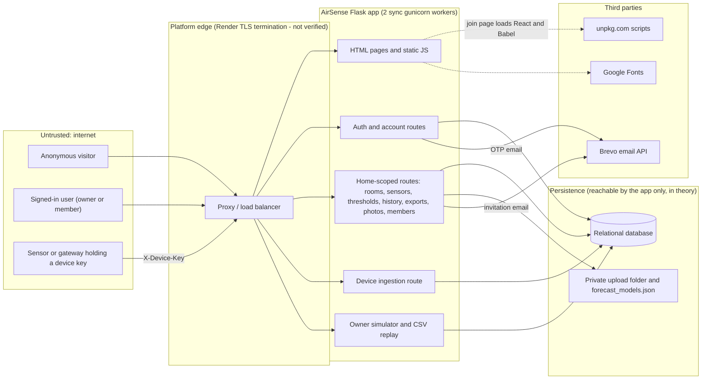

# AirSense threat model

| Field | Value |
|---|---|
| Document | 16 — Threat model |
| Version / status | 1.0 — draft for team review |
| Date | 11 November 2026 |
| Code baseline | branch `shreya`, commit `ce1a862` (112 commits) |
| Relationship to other docs | Expands the one-page table in [document 08](08_data_classification_and_threat_model.md), which is kept as the data-classification note. Controls are cross-referenced to the [security checklist](09_security_checklist.md). |

## 1. Purpose, scope and method

### 1.1 Purpose

This document identifies threats to AirSense, the components they affect, the impact if they succeed, the controls that **actually exist in the code**, and what risk remains. It is based on the implementation at the baseline commit. Where a control is only described in documentation, planned, or depends on a deployment that was not inspected, it is reported as such and is **not** counted as a mitigation.

### 1.2 Scope

| In scope | Out of scope (not assessed) |
|---|---|
| Flask application, routers, services, models, migrations | Any live deployment (the `render.yaml` service, `airsense-85qa.onrender.com`) |
| Browser code and templates served by the app | Azure SQL scripts under `database/`, Azure Blob Storage, Power BI (not wired into the app; the `.pbix` is zero bytes) |
| Device ingestion API and the AirGradient payload adapter | Physical sensor hardware, firmware, calibration, device-side key storage |
| Outbound Brevo email adapter (code only) | Brevo account configuration, DNS/SPF/DKIM, delivery |
| `render.yaml`, `.env.example`, CI workflow, dependency manifests | Render platform controls, network/firewall rules, backups, monitoring |
| Offline forecasting module (data handling only) | Forecast accuracy / ML model risk |

### 1.3 Method

1. Read the README, architecture, security-checklist and data-model documents.
2. Manual review of the source files listed in Appendix A.
3. Ran the existing automated suite locally (SQLite): **202 passed** (the README quotes an older "77 tests and 64 subtests" baseline).
4. Wrote and ran targeted probes against throw-away local instances to confirm or refute weaknesses suspected from reading the code (Appendix B). No probe was run against any hosted system.
5. Ran `pip-audit` on `requirements.txt` (no known vulnerabilities at the resolved versions on 11 Nov 2026) and `bandit` on `app/` (2 findings, both false positives — a hard-coded HTTPS URL passed to `urlopen`, and an empty-string `token=""` template argument).
6. Searched the full git history (all branches) for key-like strings and for committed `.env`, SQLite, upload or key files; none found. This was a pattern search, not an exhaustive secret scan.

**Evidence tags** used in the control and scenario text:

| Tag | Meaning |
|---|---|
| `[code]` | Read in the source; behaviour not executed |
| `[test]` | Behaviour is exercised by an existing automated test (file named) |
| `[probe]` | Reproduced during this review (Appendix B) |
| `[inferred]` | Follows from code/config but was not executed or measured |

**Risk rating.** *Residual risk* is the reviewer's qualitative judgement of likelihood × impact **after** the existing controls, assuming a public deployment as described by `render.yaml`. It is not measured data. Levels: **Low**, **Medium**, **High**, and **Unverified** (depends on deployment facts that no evidence supports either way). Categories use STRIDE letters (Spoofing, Tampering, Repudiation, Information disclosure, Denial of service, Elevation of privilege).

## 2. System overview

AirSense is a Flask modular monolith: server-rendered HTML plus vanilla JavaScript, SQLAlchemy models, a relational database (SQLite locally, PostgreSQL in CI and via `DATABASE_URL`), and a private upload folder on the application filesystem. Browsers use a signed-cookie session; sensors use a per-sensor key.

### 2.1 Roles and capabilities (as implemented)

Roles are home-scoped `owner` and `member` only. There is no administrator or facility-manager role and no role-change operation `[code]`. Every registered user automatically owns a home, and any signed-in user can create further homes `[code]`.

| Capability | Anonymous | Member | Owner | Device key |
|---|---|---|---|---|
| View readings, history, predictions, rooms, sensors, alerts | No | Yes | Yes | No |
| Export history as CSV / PDF | No | Yes | Yes | No |
| See other members' emails | No | Yes | Yes | No |
| Acknowledge alerts | No | Yes | Yes | No |
| Upload / view / delete room photos (any photo in the home) | No | Yes | Yes | No |
| Create rooms, edit rooms, provision / rotate / revoke sensors, edit thresholds | No | No | Yes | No |
| Submit simulated readings, replay a CSV | No | No | Yes | No |
| Invite / remove members, read the activity (audit) log | No | No | Yes | No |
| Post readings for its own room only | No | No | No | Yes |

(Documentation discrepancy: the README says members can submit simulator readings; the code restricts this to owners — see Appendix C.)

## 3. Assets

| ID | Asset | Where it lives | Main concern |
|---|---|---|---|
| A-01 | Account credentials (scrypt hash, OTP and reset-token hashes) | `users`, `email_challenges` | Confidentiality |
| A-02 | Session cookie and CSRF token | Browser; signed with `SECRET_KEY` | Confidentiality, integrity |
| A-03 | Device keys (one-time raw value; stored as HMAC-SHA256 with pepper) | Device; `sensors.key_hash` | Confidentiality, integrity |
| A-04 | Household context: home/room names, membership, member emails, invitations | `homes`, `rooms`, `home_memberships`, `home_invitations` | Confidentiality |
| A-05 | Environmental readings with room and timestamp (can reveal occupancy patterns) | `air_readings` | Confidentiality, integrity |
| A-06 | Thresholds and alert state | `threshold_policies`, `alerts` | Integrity, availability |
| A-07 | Audit records | `audit_log` | Integrity, non-repudiation |
| A-08 | Room photos | Private upload folder | Confidentiality, availability |
| A-09 | Exports (CSV/PDF) | Generated on request, not stored | Confidentiality |
| A-10 | Secrets: `SECRET_KEY`, `AIRSENSE_DEVICE_KEY_PEPPER`, `DATABASE_URL`, `BREVO_API_KEY` | Environment variables | Confidentiality |
| A-11 | Service availability and reputation (including Brevo sender reputation) | Whole system | Availability |
| A-12 | Trust in alert semantics (real vs simulated data, advisory thresholds) | Alert pipeline, UI wording | Integrity |

## 4. Threat actors

| ID | Actor | Capability assumed |
|---|---|---|
| TA-1 | Anonymous internet user | Can call any unauthenticated route, scripts requests, many IPs |
| TA-2 | Registered user | Self-registers (no approval); automatically owns a home; can create more homes |
| TA-3 | Household member | Legitimate read access to one home; may turn malicious |
| TA-4 | Household owner | Full control of one home; may be compromised |
| TA-5 | Holder of a leaked device key | Can post readings as one sensor until the key is revoked or rotated |
| TA-6 | Network observer / MITM | Position between client or device and the server |
| TA-7 | Compromised third-party script host or dependency | Can serve malicious JavaScript or code |
| TA-8 | Operator / anyone with database or filesystem access | Out of the application's control |

Nation-state adversaries and physical attacks on devices are out of scope.

## 5. Entry points and trust boundaries

| Entry point | Authentication | CSRF | Rate limited | Audited |
|---|---|---|---|---|
| `/register*`, `/login`, `/forgot-password*`, `/verify-*`, `/api/auth/*` | None (anonymous) | Yes (session-bound token, also pre-login) | Yes (persistent buckets) | Known accounts only |
| `GET /join?token=` | None; stores the token hash in the session | n/a | No | Acceptance audited |
| `GET /api/health` | None; runs `SELECT 1` | n/a | No | No |
| Home-scoped reads (`/api/homes/<id>/…`) | Session + membership | n/a | No | No |
| Home-scoped writes | Session + owner (or member for alerts/photos) | Yes | Only invitations, demo readings, replay | Rooms, sensors, thresholds, members: yes. **Photos and exports: no** |
| `POST /api/sensors/<id>/readings` | `X-Device-Key` | n/a (no cookie auth) | Yes — 120/min per sensor id + IP, **checked before authentication** | Ingest, reject, auth-failure |
| Legacy `/api/readings`, `/api/policies`, `/api/dashboard`, `/api/alerts` | Session (+ optional bearer token gate) | Yes | No | Partly |

**Trust boundaries**

- **TB-1** Internet ↔ application (all inputs untrusted).
- **TB-2** Signed-in user ↔ other households' data (tenant isolation is enforced in application code, not by the database `[code]`).
- **TB-3** Member ↔ owner privileges inside one home.
- **TB-4** Device ↔ server (bearer secret only; no message signing).
- **TB-5** Application ↔ database/filesystem (single credential; same `DATABASE_URL` is used for the pre-deploy migration step `[inferred]`).
- **TB-6** Application/browser ↔ third parties (Brevo, unpkg.com, Google Fonts).

## 6. Threat register (summary)

| ID | Threat | STRIDE | Primary components | Residual |
|---|---|---|---|---|
| T-01 | Credential guessing / stuffing against login | S | `routers/auth.py`, `security/passwords.py` | Low |
| T-02 | Targeted lockout of a victim's account | D | `routers/auth.py`, `security/rate_limit.py` | **Medium** |
| T-03 | Stolen session cookie remains valid after logout | S, E | `security/sessions.py`, Flask session | **Medium** |
| T-04 | Cross-site request forgery | T | `security/sessions.py` | Low |
| T-05 | Account enumeration | I | `routers/auth.py` | Low |
| T-06 | Unverified email ownership (default configuration) | S | `routers/auth.py`, `config.py` | Low |
| T-07 | OTP / password-reset abuse | S | `routers/auth.py` | Low |
| T-08 | Open redirect after login | S, I | `routers/auth.py` | **Medium** |
| T-09 | Cross-home data access (IDOR) | I, T | all home-scoped routers | Low |
| T-10 | Member exceeds privileges / malicious member | E, I | `routers/*`, `security/sessions.py` | Low |
| T-11 | Compromised owner suppresses alerts or tampers with settings | T, R | thresholds, sensors, audit | **Medium** |
| T-12 | Cross-tenant interference through the global `metrics` table | T, I | `models/metric.py`, `repositories/alerts.py` | Low |
| T-13 | Leaked device key used to fabricate readings | S, T | `routers/sensor_readings.py`, `security/device_keys.py` | **Medium** |
| T-14 | Malformed, extreme, stale or duplicate readings | T | `services/ingestion/*` | Low |
| T-15 | Unauthenticated write amplification and unbounded table growth | D | rate limiter, device route, audit log | **Medium** |
| T-16 | Malicious or oversized CSV replay upload | D, T | `routers/demo.py`, `sources/dalton_replay.py` | **Medium** |
| T-17 | Spreadsheet formula injection through exports | T | `csv_safety.py`, `routers/history.py` | Low |
| T-18 | Malicious room-photo upload; photo privacy | D, I | `routers/uploads.py`, `services/blob_storage.py` | **Medium** |
| T-19 | Cross-site scripting | T, I | templates, `static/js/*` | Low |
| T-20 | Third-party script compromise; weak CSP | T, E | `templates/auth/join.html`, `main.py` | **Medium** |
| T-21 | SQL injection | T, I | ORM layer | Low |
| T-22 | Secret exposure and fail-open configuration | I, E | `config.py`, `main.py`, `render.yaml` | **Medium** |
| T-23 | Eavesdropping / MITM on browser or device traffic | I | deployment, device clients | Unverified |
| T-24 | Database / storage compromise, loss or tampering | I, T, D | database, upload folder | Unverified |
| T-25 | Insufficient audit coverage and integrity | R | `services/audit.py`, routers | **Medium** |
| T-26 | Email abuse (spam/phishing relay) and provider dependency | D, S | invitations, OTP email | **Medium** |
| T-27 | Resource exhaustion by authenticated users | D | create-home/room/sensor, exports, photos | **Medium** |
| T-28 | Privacy exposure and absent retention/deletion | I | data model, exports, photos | **Medium** |
| T-29 | Dependency and build-pipeline compromise | T | `requirements.txt`, CI | Low |
| T-30 | Misinterpretation of advisory output; missed alerts | — (safety) | alert pipeline, UI | **Medium** |

No threat is rated **High**. The weaknesses confirmed in this review need either a specific target or a motivated attacker and mostly affect a demo-scale system; that judgement would change for a deployment holding real household data or relied on as a safety device. Two items are **Unverified** because the deployment was not inspected.

## 7. Threat details

### 7.1 Identity and session

#### T-01 Credential guessing / stuffing
- **Scenario.** An attacker tries leaked or common passwords against `/login` or `/api/auth/login`.
- **Affected / impact.** User accounts; an owner takeover exposes a household's data and controls (see T-11).
- **Existing controls.** scrypt hashing via Werkzeug and a 12–256 character policy requiring a letter and a digit `[code]`. Failure counters are persistent and shared across workers: 10 failures per IP and 10 per email per 15 minutes `[code][probe]`. A dummy hash is verified for unknown emails, and error text is identical for unknown email and wrong password `[code]`. Related tests: `tests/test_auth_rate_limits.py`.
- **Residual.** **Low.** No MFA, no breached-password check, no user-visible notification of failed logins. Shared NAT addresses share one IP counter.
- **Recommendation.** Offer optional TOTP for owners; consider a breached-password check.

#### T-02 Targeted lockout of a victim's account
- **Scenario.** An attacker who knows a victim's email sends 10 wrong-password requests. The per-email failure bucket then rejects *all* sign-ins for that email — including the correct password — until the 15-minute window expires, and can be refreshed indefinitely with about 10 requests per window.
- **Affected / impact.** Availability of the dashboard and alerts for the victim. Password reset still works (it uses separate counters) but the login bucket stays full afterwards until it expires.
- **Existing controls.** None specific; the throttle is the cause. `[probe]` P3: after 10×401, a request with the **correct** password returned 429.
- **Residual.** **Medium.**
- **Recommendation.** Key the failure counter on email **and** IP (or use progressive delay / CAPTCHA), and never let the counter reject a request whose credentials are correct.

#### T-03 Stolen session cookie remains valid after logout
- **Scenario.** An attacker obtains a session cookie (shared computer, malware, proxy log) and replays it after the user has signed out.
- **Affected / impact.** Full access as the user for up to 14 days (`PERMANENT_SESSION_LIFETIME`). For an owner this includes sensor keys, members and thresholds.
- **Existing controls.** Cookie is `HttpOnly`, `SameSite=Lax`, and `Secure` is forced in production `[code]`. `session_version` invalidates all sessions, but it is incremented **only on password reset** `[code]`. `is_active` and membership are re-read from the database on every request `[code]`. Sessions are client-side signed cookies; there is no server-side session store `[code]`. `[probe]` P2: a cookie captured before logout still returned 200 from `/api/me` afterwards.
- **Residual.** **Medium.** Also no idle timeout, no "sign out everywhere", and no re-authentication for sensitive actions (key rotation, member removal).
- **Recommendation.** Increment `session_version` on logout (or move to server-side sessions); shorten lifetime and add idle timeout; require recent authentication for owner actions.

#### T-04 Cross-site request forgery
- **Scenario.** A malicious site makes a victim's browser submit a state-changing request.
- **Affected / impact.** Any authenticated mutation.
- **Existing controls.** Every `POST/PUT/PATCH/DELETE` behind `require_user` verifies a per-session token with a constant-time compare `[code]`; login, registration, reset and logout also verify it `[code]`; `SameSite=Lax` `[code]`. Rejection of a bad token is tested (`tests/test_access_control.py`). The device route is exempt by design because it uses a header key, not a cookie.
- **Residual.** **Low.** CSRF coverage depends on every new mutating route using `require_user`; `GET /join?token=` writes to the session on a GET (limited effect).
- **Recommendation.** Add a test that fails when a mutating route lacks CSRF verification.

#### T-05 Account enumeration
- **Scenario.** An attacker learns which emails have accounts.
- **Existing controls.** Login, forgot-password, resend and the OTP registration step return generic responses `[code]`.
- **Residual.** **Low.** On the default (non-OTP) registration path, an existing email returns `409` and a new one `201` `[probe]` P4. `forgot-password` does extra work (a network call to Brevo) only for existing accounts, so response time likely differs `[inferred]`.
- **Recommendation.** Return a uniform response and perform equivalent work for unknown addresses.

#### T-06 Unverified email ownership (default configuration)
- **Scenario.** `EMAIL_VERIFICATION_REQUIRED` is `false` in both `render.yaml` and `.env.example`. Registration sets `email_verified_at` immediately, so anyone can create an account for an email they do not control. The OTP pre-registration step is optional: omitting `otp` from the request skips it `[code][probe]`.
- **Affected / impact.** Address squatting; the invitation check `email_verified_at is not None` is always satisfied. A pre-registered victim email cannot be registered by its real owner (they must use password reset). Invitation acceptance still needs the single-use emailed token, so impact is limited.
- **Existing controls.** Invitation acceptance requires token + matching email `[code][test]` (`tests/test_invitation_acceptance_flow.py`); password reset proves control of the mailbox.
- **Residual.** **Low** today; becomes **Medium** if any feature starts trusting the email address (alert emails, sharing by email).
- **Recommendation.** Enable verification for production and reject registration without a valid challenge.

#### T-07 OTP / password-reset abuse
- **Scenario.** Brute-forcing a 6-digit code; replaying a reset token; mail-bombing a victim.
- **Existing controls.** Codes expire in 10 minutes, allow 5 attempts per challenge, 60-second resend cooldown, per-email and per-IP limits (e.g. 3 sends per email per 15 minutes) `[code]`. Reset tokens are random, expire in 15 minutes, are claimed with a single atomic update, and a successful reset increments `session_version` `[code]`. Responses are generic `[code]`.
- **Residual.** **Low.** OTP and reset hashes are `SHA-256(SECRET_KEY + value)` — a fast hash over a small space, safe only while `SECRET_KEY` is secret; `SECRET_KEY` is also the session-signing key, so rotating it invalidates sessions and outstanding codes together `[code]`.
- **Recommendation.** Use HMAC with a dedicated key for challenge hashing.

#### T-08 Open redirect after login
- **Scenario.** A phishing link `…/login?next=/%09/evil.example` (a tab character after the slash). After the victim signs in, the server redirects to `//evil.example`.
- **Affected / impact.** Users are sent from the trusted domain to an attacker page immediately after authenticating (credential-phishing aid). Same check is used in `POST /verify-email` (`next` form field).
- **Existing controls.** The check rejects values not starting with `/` and values starting with `//` `[code]`. `[probe]` P1: `https://evil.example` and `//evil.example` are neutralised and backslash forms are percent-encoded by Werkzeug, **but** the tab variant passes the check and is emitted as `Location: //evil.example`. Verified at the response-header level; browser behaviour not executed.
- **Residual.** **Medium** — exploitable today, trivial to fix.
- **Recommendation.** Reject control characters and backslashes, then require that `urlsplit(next)` has no scheme and no netloc; or allow only a fixed set of in-app paths.

### 7.2 Authorization and tenancy

#### T-09 Cross-home data access (IDOR)
- **Scenario.** A signed-in user substitutes another home, room, sensor, alert or photo identifier.
- **Affected / impact.** Another household's readings, members, photos and settings.
- **Existing controls.** Every home-scoped route calls `require_home_role`; non-members get `404`, non-owners `403` on owner routes `[code]`. Child objects are looked up *with* their `home_id` (rooms, sensors, photos) and alert acknowledgement authorises against the alert's own home `[code]`. Tests: `test_api_requires_authentication_and_isolates_homes`, `test_member_cannot_mutate_owner_only_resources`, `test_room_photo_requires_membership_and_supports_authorized_upload`.
- **Residual.** **Low.** Isolation lives only in application code: the active schema has no composite same-home foreign keys (README acknowledges this), and there is no central enforcement, so each new route must remember the check. Acknowledging a non-existent alert id returns a different error body than an existing alert in another home, a weak existence oracle on sequential ids `[code]`.
- **Recommendation.** Add composite constraints or a route-coverage test that enumerates all routes and asserts an authorization check.

#### T-10 Member exceeds privileges / malicious member
- **Scenario.** A member tries owner actions, or abuses allowed actions.
- **Existing controls.** Invitations can only create `member`; there is no role-change endpoint; owner-only checks on rooms, sensors, thresholds, invitations, members, replay and audit `[code][test]`. Removing a member takes effect immediately because membership is read per request `[code]`.
- **Residual.** **Low** for escalation. By design a member can export all history, see member emails, acknowledge alerts, and upload or delete **any** photo in the home; exports and photo operations are not audited (T-25).
- **Recommendation.** Decide whether photo deletion should be owner-only; audit exports and photo operations.

#### T-11 Compromised owner suppresses alerts or tampers with settings
- **Scenario.** An attacker with an owner session (T-03) or a malicious owner raises thresholds, revokes sensors, removes members, or injects simulated readings.
- **Affected / impact.** Alert integrity (A-06, A-12) for every member of the home; members would not receive any warning.
- **Existing controls.** Threshold changes, sensor and membership changes are written to the audit log with the actor `[code]`; simulated and dataset readings are labelled by `source` `[code]`. The legacy `/api/policies` route validates only that values are finite and non-negative `[code]`.
- **Residual.** **Medium.** Only owners can read the audit log, members are not notified of threshold changes, there is one owner per home with no transfer, and no MFA/step-up exists.
- **Recommendation.** Notify members of threshold/sensor changes; add sanity bounds; add MFA for owners.

#### T-12 Cross-tenant interference through the global `metrics` table
- **Scenario.** Metrics are keyed by code across **all** homes. For unrecognised (custom) metric codes the first creator fixes the unit and display name; a later submission in another unit is rejected. Any owner, device, or CSV header can create new metrics. The history filter also distinguishes "unknown metric" from "known", revealing which custom codes exist in other households `[code]`.
- **Existing controls.** Recognised parameters are normalised to canonical units so they cannot be hijacked `[code]`; metric codes and units are regex-validated; names are HTML-escaped in the UI `[code]`.
- **Residual.** **Low** (nuisance and a small metadata leak). **Recommendation.** Scope custom metrics to a home or restrict creation to a fixed catalogue.

### 7.3 Device ingestion

#### T-13 Leaked device key used to fabricate readings
- **Scenario.** A key is read from device firmware, a log, a screenshot or the one-time provisioning response, or sniffed on a non-TLS link (T-23). The attacker posts readings that raise false alerts or mask real ones.
- **Affected / impact.** Data and alert integrity for the sensor's room; false sense of safety (T-30).
- **Existing controls.** 256-bit random key; stored as HMAC-SHA256 with a server pepper; constant-time comparison; shown once; owner can rotate or revoke; key bound to one sensor, room and home; payload validated (types, finite values, plausibility ranges for recognised metrics, metric/unit syntax, room must equal the sensor's room); live readings must be ≤ 60 s in the future and ≤ 24 h old; duplicate home/room/metric/timestamp is rejected; failed authentication and rejected readings are audited `[code]`. Related tests: `tests/test_ingestion.py`, `tests/test_provisioning.py`.
- **Residual.** **Medium.** The key is a bearer secret with no expiry, no request signing and no per-device anomaly detection. A thief can back-fill up to 24 hours and keep posting plausible values until the owner notices. Rotation invalidates the old key immediately (operationally disruptive). Changing the pepper invalidates every device key.
- **Recommendation.** Add key expiry/rotation reminders, optional request signing or mTLS for gateways, and a stale/implausible-pattern alert.

#### T-14 Malformed, extreme, stale or duplicate readings
- **Scenario.** Non-numeric, infinite, negative, unit-confused or future-dated values; request floods of duplicates.
- **Existing controls.** `validate_reading` and unit normalisation `[code]`; per-metric plausible ranges for recognised metrics `[code]`; atomic processing with rollback `[code]`; unique reading key and unique open-alert index `[code][test]`; dataset replay ≤ 1,000 rows and duplicates skipped `[code]`.
- **Residual.** **Low.** Custom (unrecognised) metrics have no upper plausibility bound.

#### T-15 Unauthenticated write amplification and unbounded table growth
- **Scenario.** The device route rate-limits **before** authenticating and keys the bucket on `sensor_id + IP`. An attacker requests random sensor ids; each one inserts a new `rate_limit_buckets` row and commits, and none is ever throttled. No code purges old buckets. Separately, every accepted reading writes an audit row, and failed authentications for a real sensor id write another (≤ 120/min per IP).
- **Affected / impact.** Database growth and write load; audit log noise that can bury genuine events (T-25).
- **Existing controls.** The per-key throttle works for a repeated id `[probe]` P5 (120 allowed, then 429). Unknown sensor ids do not write audit rows `[code]`.
- **Residual.** **Medium.** `[probe]` P5: 200 requests with 200 random ids created 200 rows and all returned 401 unthrottled.
- **Recommendation.** Validate the id format before touching the database; add an IP-level bucket independent of `sensor_id`; schedule bucket purging; cap or aggregate audit rows for repeated failures.

### 7.4 Content handling

#### T-16 Malicious or oversized CSV replay upload
- **Scenario.** An owner (any registered user, via their own home) uploads a large or crafted CSV.
- **Existing controls.** Owner-only; `.csv/.txt` extension and MIME allowlist; 16 MB file cap (17 MB request cap); 1,000-row cap; cell/unit/timestamp validation; duplicate skipping; all-or-nothing transaction; 10 replays per 15 minutes per home and user `[code]`.
- **Residual.** **Medium.** Up to 16 MB is read, decoded and parsed in memory per request on 2 synchronous workers `[inferred]`; because every user owns a home, the per-home limit is multiplied by creating accounts/homes. Uploaded headers can create custom global metrics (T-12).
- **Recommendation.** Stream-parse with a byte limit before decoding; add a global/IP limit; lower the file cap.

#### T-17 Spreadsheet formula injection through exports
- **Existing controls.** `safe_csv_cell` strips control characters and prefixes `'` when the first significant character is `= + - @`; applied to every text cell of the CSV export `[code][test]` (`tests/test_csv_exports.py`). The PDF writer escapes `( ) \` and non-ASCII `[code]`.
- **Residual.** **Low.** Numeric cells are not altered (acceptable).

#### T-18 Malicious room-photo upload; photo privacy
- **Scenario.** A member uploads a polyglot file, a very large number of files, or an image with GPS EXIF; another member downloads it.
- **Existing controls.** Extension allowlist, declared MIME must match, magic-byte check, 5 MB cap, server-generated random filename, filename regex on read/delete (no traversal), per-home/room hashed directory outside `static/`, membership check on every route, `nosniff`, `Cache-Control: private, no-store`, MIME derived from the extension `[code][test]` (`tests/test_room_uploads.py`).
- **Residual.** **Medium.** Files are stored **as uploaded** — no re-encoding or metadata stripping, so EXIF location data persists and any member can fetch it. The upload route has no rate limit and no per-room or per-home quota `[code]`, so any member can fill the disk (and Render's filesystem is ephemeral, so photos vanish on redeploy unless a persistent disk is configured). Uploads and deletions are not audited.
- **Recommendation.** Re-encode images and strip metadata; add quotas and rate limits; audit upload/delete.

#### T-19 Cross-site scripting
- **Scenario.** A hostile room, sensor, display or metric name, or alert/audit detail is rendered as markup for other members.
- **Existing controls.** Jinja autoescaping; configuration is passed to scripts with `|tojson`; every `innerHTML` sink reviewed in `static/js/dashboard.js`, `history.js` and `predictions.js` passes user-controlled values through an `escapeHtml/esc` helper or uses `textContent`; email templates use `html.escape`; `object-src 'none'`, `frame-ancestors 'none'` `[code]`.
- **Residual.** **Low** for current code (review was of the sinks found by search, not exhaustive). The CSP provides **no** backstop because it allows `'unsafe-inline'` scripts (T-20), so any future unescaped sink would be directly exploitable. `static/dashboard.js` is an unreferenced duplicate of the live script and should be removed to avoid confusion.

#### T-20 Third-party script compromise; weak CSP
- **Scenario.** `templates/auth/join.html` loads `react@18` and `react-dom@18` (floating major version) and `@babel/standalone@7.26.10` from `unpkg.com` with **no Subresource Integrity**. The page is rendered for signed-in users and contains their CSRF token `[code]`. The CSP allows `https://unpkg.com` and `'unsafe-inline'` for scripts **on every page**.
- **Affected / impact.** A compromised package or CDN could run script in an authenticated session (act as the user, read the CSRF token and API data).
- **Existing controls.** `HttpOnly` cookie prevents direct cookie theft; other pages use only same-origin scripts `[code]`.
- **Residual.** **Medium** (low likelihood, high impact). Google Fonts additionally discloses visitor IPs to a third party.
- **Recommendation.** Self-host pinned React or drop it for a static animation; remove Babel; add SRI; remove `unpkg.com` and `'unsafe-inline'` from `script-src` (use nonces for the remaining inline scripts).

#### T-21 SQL injection
- **Existing controls.** All queries use the SQLAlchemy ORM / expression API; the only raw SQL is the constant `SELECT 1` health check `[code]`; `bandit` reported no injection findings `[probe]`.
- **Residual.** **Low.** No adversarial testing was performed.

### 7.5 Platform, operations and data lifecycle

#### T-22 Secret exposure and fail-open configuration
- **Scenario.** Weak or default secrets are used, or a required setting is missing in production.
- **Existing controls.** With `APP_ENV=production` the app refuses to start with the default `SECRET_KEY` or an empty pepper, and forces secure cookies `[probe]`. `render.yaml` generates `SECRET_KEY` and leaves pepper, database URL and Brevo key as manually-set (`sync: false`). `.env` files are git-ignored and no key-like strings or database/upload files were found in history `[probe]`.
- **Residual.** **Medium.** The guard only works if `APP_ENV=production` is set: otherwise the app runs with the well-known development key, non-secure cookies and no HSTS `[probe]` P6. Outside production an empty pepper silently falls back to `SECRET_KEY`. One secret serves session signing and OTP/reset hashing. Neither CI nor the repository runs secret scanning, and no `SECURITY.md` or disclosure policy exists.
- **Recommendation.** Fail closed when `APP_ENV` is unset on a non-local host; split secrets by purpose; add secret scanning and a security contact.

#### T-23 Eavesdropping / MITM on browser or device traffic
- **Existing controls.** Production forces `Secure` cookies and sends HSTS (`max-age=31536000`) when the request is secure after honouring one proxy hop of `X-Forwarded-Proto` `[code][probe]`. `[test]` `tests/test_security_headers.py`.
- **Residual.** **Unverified.** No in-app HTTP→HTTPS redirect exists; enforcement relies on the platform, which was not tested. A device configured with `http://` would send its key in clear text `[inferred]`. HSTS lacks `includeSubDomains`/`preload`.
- **Recommendation.** Verify the live endpoint; document that devices must use HTTPS; consider rejecting device requests that arrive over HTTP in production.

#### T-24 Database / storage compromise, loss or tampering
- **Existing controls.** Parameterised ORM access; foreign keys (enabled for SQLite); uniqueness/check constraints; Alembic migrations tested on SQLite and PostgreSQL in CI; schema auto-creation off by default `[code][test]`.
- **Residual.** **Unverified.** Not evidenced: database network restrictions, least-privilege identity (the pre-deploy migration and the runtime appear to share one URL `[inferred]`), encryption at rest, backups and restore, retention, monitoring. The audit log has no tamper protection in the active schema (the append-only triggers exist only in the unapplied Azure scripts). Photos and `forecast_models.json` live on the application filesystem. Treat as potentially High until evidence exists.
- **Recommendation.** Use a restricted runtime role distinct from the migration role; document and test backup/restore; restrict network access.

#### T-25 Insufficient audit coverage and integrity
- **Scenario.** Malicious or accidental actions cannot be reconstructed.
- **Existing controls.** Audited: login success/failure (known accounts), logout, password reset, registration, invitations, joins, removals, room/sensor/threshold changes, ingestion, rejections, device authentication failures, and alert created / acknowledged / all-clear events `[code][test]` (`tests/test_audit.py`). Secrets are not written to details `[code]`.
- **Residual.** **Medium.** **Not** audited: data exports (CSV/PDF), photo upload/delete, reads, unknown-account login failures, request-level rejections. Only owners can view the log; there is no export, retention policy, alerting or tamper evidence; the invitee's email is stored in `member.invited` details; one audit row per accepted reading inflates the table (T-15).
- **Recommendation.** Audit exports and photo operations; define retention; consider sampling `reading.ingested`.

#### T-26 Email abuse (spam/phishing relay) and provider dependency
- **Scenario.** Any registered user can send AirSense-branded invitation emails to arbitrary addresses: the 20-per-15-minutes limit is keyed on home and user, and `POST /api/homes` is unlimited, so new homes reset it. The sender's display name (up to 120 characters, attacker-chosen) is embedded in the text, as it is in registration OTP emails sent to arbitrary recipients.
- **Affected / impact.** Brevo sender reputation/quota; recipients receive misleading content from a legitimate sender. The Brevo call is synchronous with a 10 s timeout inside the request on unauthenticated routes, so a slow provider can occupy the 2 sync workers `[inferred]`.
- **Existing controls.** All inserted text is HTML-escaped; fixed subjects; OTP sends limited to 3 per email and 8 per IP per 15 minutes; invitation tokens expire in 24 hours and are single-use `[code]`.
- **Residual.** **Medium.**
- **Recommendation.** Rate-limit invitations per account and per recipient domain globally; send email asynchronously; constrain display-name characters in email.

#### T-27 Resource exhaustion by authenticated users
- **Scenario.** A user scripts unbounded home, room or sensor creation, photo uploads, or repeated large exports.
- **Existing controls.** History queries are capped at 10,000 rows; replay and invitation limits (T-16, T-26) `[code]`.
- **Residual.** **Medium.** No rate limit or quota on `POST /api/homes`, room/sensor creation, photo upload, history/CSV/PDF export. The PDF is built in memory. `list_rooms` issues several queries per room and the dashboard polls every 20 s `[code]`, so many rooms degrade the app for that home's users.
- **Recommendation.** Quotas per account/home; rate limits on all mutating and export routes.

#### T-28 Privacy exposure and absent retention/deletion
- **Existing controls.** Photos and readings are authorised by membership; photos are `no-store`; no real secrets in repo `[code]`. Document 08 classifies the data.
- **Residual.** **Medium** for any real deployment. Timestamped room readings reveal occupancy patterns; members see each other's emails; photos keep EXIF; authenticated pages and JSON carry no `Cache-Control` header (only photos do) `[probe]`; there is **no** account, home or data deletion, no data export for the data subject, no retention schedule or privacy notice. This is a technical observation, not a legal assessment.
- **Recommendation.** Implement account/home deletion and retention rules; add `Cache-Control: no-store` to authenticated responses.

#### T-29 Dependency and build-pipeline compromise
- **Existing controls.** Runtime dependencies are few and version-bounded by range; `pip-audit` found no known vulnerabilities at the versions resolved on 11 Nov 2026 (Flask 3.1.3, Werkzeug 3.1.9, SQLAlchemy 2.1.8, gunicorn 23.0.0) `[probe]`; CI runs tests and migrations on SQLite and PostgreSQL `[code]`.
- **Residual.** **Low.** Ranges without a lock file or hashes mean builds are not reproducible; no Dependabot, `pip-audit`, `bandit` or secret scanning in CI; GitHub Actions are referenced by tag (`@v4`) rather than commit SHA and the workflow sets no explicit `permissions`.
- **Recommendation.** Add a lock file, Dependabot, `pip-audit`/`bandit` jobs, and minimal workflow permissions.

### 7.6 Safety and trust

#### T-30 Misinterpretation of advisory output; missed alerts
- **Scenario.** A user treats simulated data or illustrative thresholds as a safety guarantee, or a hazardous condition occurs while nobody has the dashboard open.
- **Existing controls.** A disclaimer ("not a medical or safety device… does not replace a certified carbon monoxide alarm") is rendered in the dashboard and README; readings carry `device` / `simulated` / `dataset` labels; dataset replay does not create live alerts; simulated data is excluded from forecast training; sensor freshness (fresh/stale) is shown; alert wording has tests (`tests/test_alert_wording.py`) `[code][test]`.
- **Residual.** **Medium.** Alerts are shown only inside the application — no email, SMS or push alert delivery exists (the email module sends only OTP and invitation messages) `[code]`. Default thresholds are illustrative and uncited (`docs/threshold-sources.md`). A silent sensor produces a "stale" label but no escalation.
- **Recommendation.** Keep the disclaimer prominent; cite or clearly label thresholds; add out-of-band notification and a sensor-offline alert before any real-world reliance.

## 8. Residual risk summary and security limitations

| Residual | Count | Threats |
|---|---|---|
| High | 0 | — |
| Medium | 15 | T-02, T-03, T-08, T-11, T-13, T-15, T-16, T-18, T-20, T-22, T-25, T-26, T-27, T-28, T-30 |
| Low | 13 | T-01, T-04, T-05, T-06, T-07, T-09, T-10, T-12, T-14, T-17, T-19, T-21, T-29 |
| Unverified | 2 | T-23, T-24 |

**Security limitations of the current implementation** (stated plainly so they are not mistaken for controls):

- No multi-factor authentication, no step-up authentication, no "sign out everywhere", and server-side session revocation only on password reset.
- Roles are only home-scoped `owner` and `member`; the PRD's administrator and facility-manager roles are not implemented.
- Tenant isolation is enforced in application code; the active database schema lacks composite same-home constraints and the audit log is not tamper-resistant.
- Device authentication is a bearer key with no signing, expiry or anomaly detection.
- Email verification is off by default in the shipped configuration.
- Rate limiting is in place for authentication, device ingestion, invitations and replay, but not for resource-creating or export routes, and its tables are never purged.
- Alerts are in-app only; thresholds are illustrative and uncited.
- No account/data deletion, retention policy, privacy notice or incident-response procedure exists.
- Nothing about the live deployment (HTTPS enforcement, database network and identity, backups, secret storage, monitoring) was verified, and no independent penetration test was performed.
- Review method limits: manual review plus targeted probes; the ML module, `parameters.py`, alert-rule logic, the AirGradient adapter and the internals of the thresholds route were not reviewed in depth.

## 9. Recommended actions (prioritised)

| Priority | Action | Addresses |
|---|---|---|
| 1 | Harden `next` validation (reject control characters/backslashes; require no scheme/netloc) | T-08 |
| 2 | Invalidate sessions on logout (bump `session_version` or server-side sessions); add idle timeout | T-03 |
| 3 | Redesign login-failure throttling so third parties cannot lock out an account | T-02 |
| 4 | Self-host or remove React/Babel on `/join`; add SRI; drop `unpkg.com` and `'unsafe-inline'` from the CSP | T-20, T-19 |
| 5 | Validate sensor-id format before DB access; add IP-level bucket; purge `rate_limit_buckets`; reduce audit noise | T-15, T-25 |
| 6 | Quotas and rate limits for homes, rooms, sensors, photos, invitations and exports | T-26, T-27, T-18 |
| 7 | Enable and enforce email verification in production; make registration responses uniform | T-06, T-05 |
| 8 | Fail closed when `APP_ENV` is unset; separate secrets by purpose; add secret scanning | T-22 |
| 9 | Add `pip-audit`, `bandit`, Dependabot and a lock file to CI; restrict workflow permissions | T-29 |
| 10 | Audit exports and photo operations; define audit retention | T-25 |
| 11 | Verify deployment: HTTPS, DB identity/network, backups, device HTTPS; record evidence with secrets redacted | T-23, T-24 |
| 12 | Add out-of-band alert delivery and cite or label thresholds before any real-world reliance | T-30 |

## 10. Assumptions and exclusions

- The reviewed code is assumed to be what would be deployed; this cannot be confirmed without deployment evidence.
- Ratings are qualitative judgements by the reviewer, not measured likelihoods.
- Probes ran against local, throw-away instances created by the application's own test configuration. They demonstrate behaviour of the code, not of any hosted service.
- This is not a penetration test, a privacy impact assessment or a legal determination.

---

## Appendix A — Files reviewed

Fully or substantially read: `app/config.py`, `app/main.py`, `app/db.py`, `app/error_handlers.py`, `app/csv_safety.py`, `app/json_request.py`; `app/security/*`; `app/routers/{auth,homes,rooms,sensors,sensor_readings,demo,uploads,audit,alerts}.py` and `history.py` (query and export paths); `app/services/{email,invitations,provisioning,audit,blob_storage}.py`, `app/services/ingestion/*`; `app/models/*` (constraints); `app/sources/dalton_replay.py` (limits and parsing flow); `app/static/js/{dashboard,history,predictions}.js` and `app/templates/*` (script sinks, escaping, third-party loads); `render.yaml`, `.env.example`, `.gitignore`, `.github/workflows/ci.yml`, `requirements*.txt`; `tests/test_access_control.py` (names and scope); repository docs listed in §1.3.

Skimmed or checked only for authorization/escaping: `routers/thresholds.py`, `routers/dashboard.py`, `services/history_report.py`, `repositories/alerts.py` (metric creation), `static/dashboard.js` (duplicate), `static/sw.js` and `manifest.webmanifest` (both zero bytes and unreferenced).

Not reviewed in depth: `app/ml/*`, `app/parameters.py`, `app/services/alerts/*`, `app/sources/{airgradient,simulator}.py`, migrations, `database/` Azure scripts.

## Appendix B — Verification performed (local, throw-away instances)

| ID | Question | Result |
|---|---|---|
| P1 | Can `next` on `POST /login` redirect off-site? | `next=/%09/evil.example` → `302 Location: //evil.example`. `//evil.example` and `https://evil.example` → `/alerts`. `/\evil.example` → `/%5Cevil.example` (encoded). |
| P2 | Does a cookie captured before logout still work after logout? | Same client: `/api/me` → 401 after logout. Replayed pre-logout cookie: `/api/me` → **200**. |
| P3 | Can a third party lock a victim out? | 10 wrong passwords for the victim's email → 10×401 then 429. A request with the **correct** password then returned 429. |
| P4 | Does registration reveal existing emails? | Existing email → 409; new email → 201 (no OTP supplied; session started). |
| P5 | Is unauthenticated bucket creation throttled? | 200 requests to 200 random sensor ids → 200 new `device:*` rows, all 401, none throttled. One repeated id: 120×401 then 429. |
| P6 | Headers and production guards | Dev: no HSTS; CSP contains `'unsafe-inline'` and `https://unpkg.com`. Production + HTTPS: HSTS `max-age=31536000`, secure-cookie setting on; default `SECRET_KEY` or empty pepper refused; with `APP_ENV` unset the dev key, non-secure cookies and no HSTS are used. Authenticated pages/JSON carry no `Cache-Control`. |
| P7 | Existing test suite | 202 passed. |
| P8 | `pip-audit -r requirements.txt` | No known vulnerabilities. |
| P9 | `bandit -r app` | 2 findings (B106, B310), both false positives. |

## Appendix C — Documentation discrepancies found

These statements in existing documents do not match the code at the baseline; correcting them would keep the submission consistent with this threat model.

1. **README → Security:** "The current rate limiter is in-memory" — the code uses database-backed buckets for all limits; `InMemoryRateLimiter` is defined but never used. (The README's production section describes it correctly.)
2. **README → Security:** members "can … submit simulator readings" — `routers/demo.py` requires the owner role.
3. **README / `docs/security-checklist.md`:** forwarded client headers are ignored "by default" and `TRUSTED_PROXY_HOPS` should stay `0` — `config.py` defaults it to `1` when `APP_ENV=production`, and always trusts one hop for the forwarded scheme in production.
4. **README:** latest baseline "77 tests and 64 subtests" — current local run is 202 passed.
5. **`docs/security-checklist.md`:** "the general reading validator accepts any finite non-negative number" — the validator also applies plausibility ranges for recognised metrics (custom metrics remain unbounded above).
6. **Document 08** names several of these areas only generically (for example "stolen cookie") and does not describe the specific weaknesses confirmed here: T-02, T-03, T-08, T-12, T-15, T-20, T-26, T-27, and the audit gaps in T-25.

## Appendix D — Mapping from document 08

| Doc 08 row | Threat IDs here |
|---|---|
| User account and session | T-01 – T-08 |
| Home/room data | T-09, T-10, T-12 |
| Sensor endpoint | T-13, T-15 |
| Reading/alert integrity | T-11, T-14, T-30 |
| CSV replay | T-16, T-17 |
| Email and invitations | T-05, T-07, T-26 |
| Private uploads | T-18 |
| Database/deployment | T-22 – T-24, T-29 |